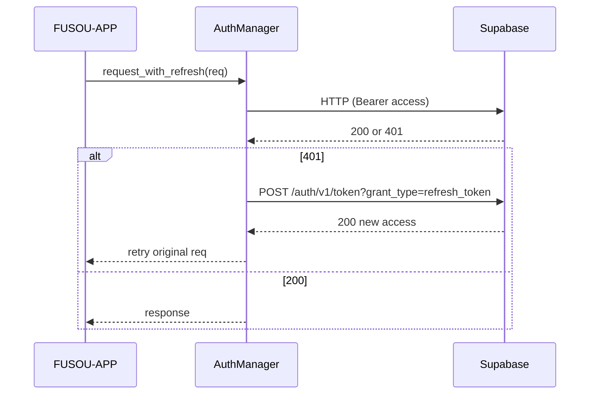
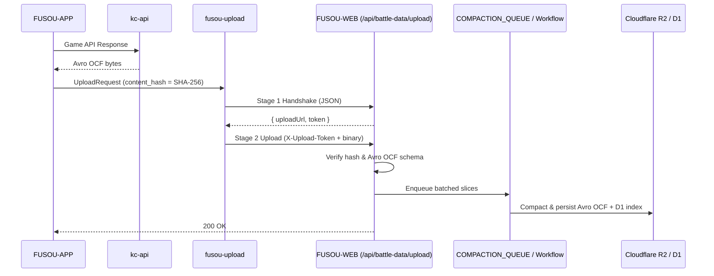
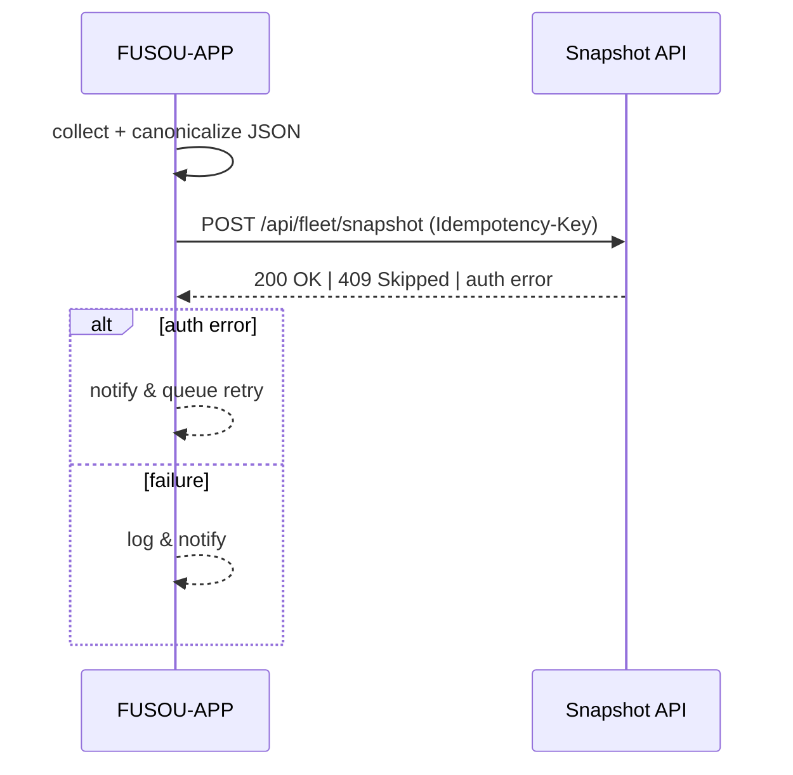
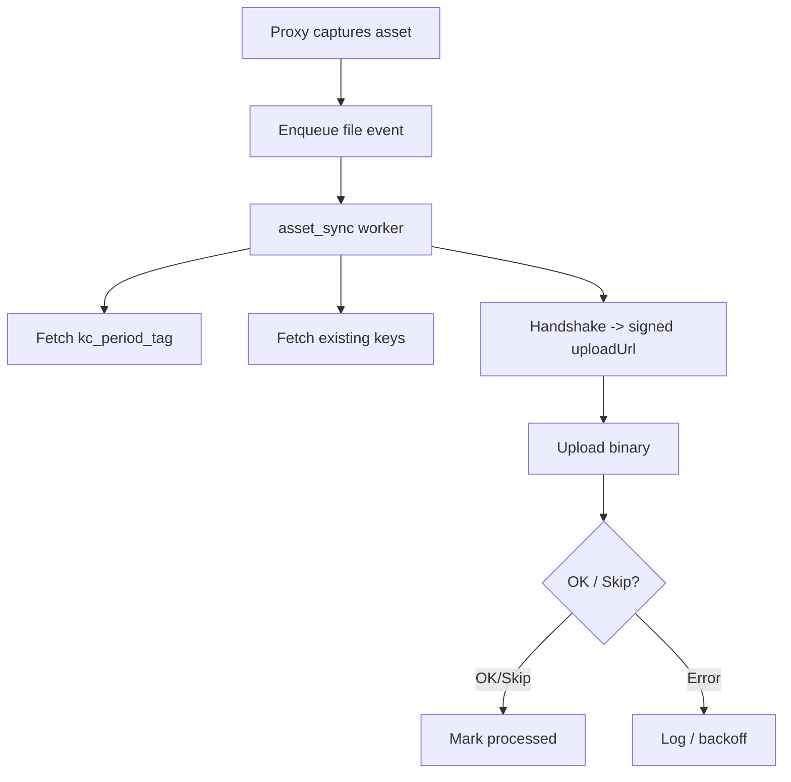
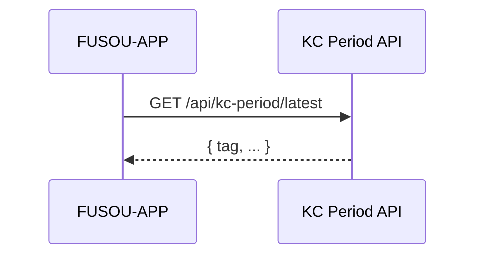
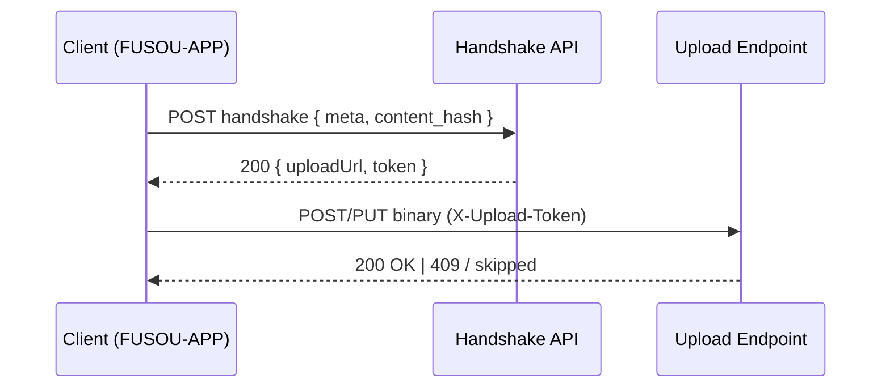

<!-- markdownlint-disable MD032 MD040 MD025 MD022 MD007 MD010 MD041 MD003 -->

# FUSOU API Overview

クライアント（FUSOU-APP / Rust クレート群）とバックエンド（Cloudflare Pages・Workers / R2 / D1 / Queues / Workflows / Supabase）の連携仕様を整理します。認証・匿名同期・署名付き 2 段階アップロード・各データの保存フローを記載します。

## 目次

- 認証・匿名同期: `fusou-auth` / Anonymous Sync v2
- ストレージ (プロバイダー別): Cloudflare R2 / Local FS
- データ種別別フロー: battle_data, fleet snapshot, asset-sync, 各種軽量データ収集
- 補助 API: KC Period
- 署名付き URL アップロードの共通仕様 (`fusou-upload`)
- Battle Data REST API

---

## 認証・セッション管理: `fusou-auth`

- 実装: `packages/fusou-auth/src/manager.rs`（`AuthManager<FileStorage>`）, `packages/FUSOU-WEB/src/server/routes/anonymous-sync-v2.ts`, `packages/FUSOU-WEB/src/server/routes/auth.ts`
- 匿名同期 (v2): デフォルト構成（`[app.auth].allow_auth = false`）では、Ed25519 デバイス鍵を用いた `/api/auth/anonymous-sync/v2/register`, `/challenge`, `/refresh`, `/pending/{token}/complete` を通じて `dataset_token` を取得・更新します。
- Supabase セッション（任意）: `AuthManager` はアクセス・リフレッシュトークンをローカルのセッションストア（`FileStorage`）に保持し、`request_with_refresh` で 401 時にリフレッシュを 1 回試行して元リクエストを再送します（接続先設定はビルド時 `option_env!` 参照）。

---

## ストレージ (プロバイダー別)

### Cloudflare R2 (共有クラウド, Avro OCF, 2 段階署名付きアップロード)

- 実装: `packages/fusou-storage/src/providers/r2/provider.rs`（`R2StorageProvider`）, `packages/fusou-upload/src/uploader.rs`（`Uploader`）
- フォーマット: **Avro OCF**（クライアント側で `kc-api` により Avro OCF 形式にエンコード。Parquet 変換は行いません）
- インデックス / バケット: Cloudflare D1（`BATTLE_INDEX_DB`）および R2 バケット（`BATTLE_DATA_BUCKET`）
- コンパクション: `FUSOU-WORKFLOW`（Cloudflare Queue / Workflow）が Avro OCF 断片を定期統合し、アーカイブ済みファイル（`archived_files` / `block_indexes` 等）として登録します。
- リトライ保護: アップロード失敗時は `PendingStore` に保留され、`UploadRetryService` が再送を試みます。

### Local FS (ローカル保存, Avro OCF / JSONL)

- 実装: `packages/fusou-storage/src/providers/local_fs/provider.rs`（`LocalFileSystemProvider`）, `packages/FUSOU-APP/src-tauri/src/senders/local_jsonl.rs`（`LocalJsonlSink`）
- 戦闘・母港・マスタデータ: `[app.database].allow_data_to_local = true` の場合、`[app.database.local].output_directory`（空なら規定のドキュメント配下）へ Avro OCF 形式で保存します。
- 軽量データ収集: 各送信モジュール（任務ツリー・艦娘成長推移・速力観測・改修ツリー）の `allow_data_to_local = true` に応じて、JSON Lines（`.jsonl`）としてローカル保存します。

> [!NOTE]
> Google Drive 連携（`packages/fusou-storage/src/providers/gdrive/`）は非推奨（deprecated）であり、デフォルトビルドでは無効化されています（`gdrive` feature 有効時のみビルド対象）。

---

## データ種別別フロー

### battle_data (port / battle 系テーブル)

- 送信条件: `[app.database].allow_data_to_shared_cloud = true` および `[app.database.r2].upload_endpoint` が設定されている場合に `R2StorageProvider` がアップロードを行います。
- 2 段階アップロード: `POST /api/battle-data/upload` に対し、Stage 1（`dataset_id`, `table`, `kc_period_tag`, `table_version`, `file_size`, `content_hash`, `path`, `binary: true`, 任意で `table_offsets`）を送信して短命トークン付き `uploadUrl` を取得し、Stage 2 でバイナリ本体を送信します。
- ハッシュ・スキーマ検証: `Uploader` が送信バイト列の SHA-256（`content_hash`）を算出してハンドシェイクに付与し、サーバー側で SHA-256 照合と Avro OCF ヘッダ／スキーマ検証（`validateAvroOCFSmart`）を実施した上で `COMPACTION_QUEUE` へ投入します。

### fleet snapshot

- 実装: `packages/FUSOU-APP/src-tauri/src/storage/snapshot.rs`（`perform_snapshot_sync_app`）, `packages/FUSOU-WEB/src/server/routes/fleet.ts`
- エンドポイント: `POST /api/fleet/snapshot`（`[app.asset_sync].fleet_snapshot_endpoint`）
- 動作: `Ships`, `UseItems`, `SlotItems`, `DeckPorts` から構築した `FleetSnapshot` JSON を `canonicalize_json` でキー順正規化し、`Idempotency-Key: <uuid>` と `content_hash` を付与して `Uploader` で 2 段階アップロードします。サーバー側で検証・gzip 圧縮して `FLEET_SNAPSHOT_BUCKET` に保存します。
- 取得: `GET /api/fleet/snapshots/list` および `GET /api/fleet/snapshot/:tag` から取得できます。

### asset-sync (静的アセット, 署名付きアップロード)

- 実装: `packages/fusou-storage/src/asset_sync.rs`, `packages/FUSOU-WEB/src/server/routes/assets.ts`
- 動作: `[app.asset_sync].asset_upload_enable = true` の場合、プロキシが保存した非 kcsapi 静的アセットをワーカーが監視し、`asset_skip_extensions`（規定 `["mp3", "woff2", "js"]`）を除外したうえで `/api/asset-sync/keys` と突き合わせ、`/api/asset-sync/upload` へ 2 段階アップロードします。

### 軽量データ収集（任意・デフォルト無効）

以下の機能は `packages/configs/configs.toml` でいずれもデフォルト `enable = false` / `allow_data_to_local = false` です。

- Quest Tree (`[app.quest_tree_sender]`): `/api/quest-tree/ingest`
- Ship Growth (`[app.ship_growth_sender]`): `/api/ship-growth/ingest`
- Soku Speed Observed (`[app.soku_speed_sender]`): `/api/soku-speed-observed/ingest`
- Remodel Data (`[app.remodel_sender]`): `/api/remodel-data/ingest`

### KC Period (期タグ取得)

- 実装: `packages/FUSOU-APP/src-tauri/src/auth/supabase.rs`（`get_period_tag`）, `packages/FUSOU-WEB/src/server/routes/kc.ts`
- エンドポイント: `GET /api/kc-period/latest`
- 用途: 現在の期タグを取得してキャッシュします。取得に失敗した場合は仮タグへのフォールバックを行わず、アップロード操作を停止してパーティション破損を防止します。

---

## 署名付き URL アップロードの共通仕様 (`fusou-upload`)

- 対象: R2 battle/master data (`r2/provider.rs`), fleet snapshot (`storage/snapshot.rs`), asset-sync (`fusou-storage/src/asset_sync.rs`)
- 共通フロー:
  1. **Phase 1 (Handshake)**: メタデータ（サイズ、`content_hash` 等）と認証ヘッダを JSON で POST し、短命トークンと `uploadUrl` を取得します。
  2. **Phase 2 (Upload)**: `uploadUrl` に対して `X-Upload-Token` 等の必要ヘッダを付与して実データ本体を送信します。サーバー側で署名と `content_hash` を再検証して保存または重複スキップ（409 / skipped）を返却します。

### Idempotency-Key と重複回避

- スナップショット送信（`snapshot.rs`）では `Idempotency-Key: <uuid>` を付与し、短時間の再試行による二重送信を抑止します。
- 署名付きアップロード系エンドポイントでは、同一 `content_hash` の既存データ、同一 `Idempotency-Key` の再送、空ペイロード（しきい値以下）等の条件で重複スキップまたは 409 を返します。

---

## Battle Data REST API

実装: `packages/FUSOU-WEB/src/server/routes/battle_data.ts`

### `POST /api/battle-data/upload` (2 段階署名付きアップロード)

- Stage 1 (Handshake): JSON で `dataset_id`, `table`, `kc_period_tag`, `table_version`, `file_size`, `content_hash`, `path`, `binary: true`（および任意で `table_offsets`）を送信
- Stage 2 (Execution): `X-Upload-Token` を付与して Avro OCF バイナリストリームを送信。サーバー検証後に `COMPACTION_QUEUE` へ投入され、`{ ok: true, table, period_tag }` を返却

### `GET /api/battle-data/chunks`

期間指定でアーカイブ済み断片メタ一覧を取得します（D1 `block_indexes` / `archived_files` 参照）。

- 必須クエリ: `dataset_id`, `table`（任意: `from`, `to`, `limit`, `offset`, `table_version`）
- キャッシュ: `Cache-Control: public, max-age=60, stale-while-revalidate=300`

### `GET /api/battle-data/latest`

最新のアーカイブ断片メタを取得します。

- 必須クエリ: `dataset_id`, `table`（任意: `table_version`）
- キャッシュ: `Cache-Control: public, max-age=60, stale-while-revalidate=300`

---

## 呼び出しタイミングまとめ

- `StorageService::integrate_port_table` / `get_data_table`: 有効なストレージプロバイダー（`LocalFS` / `R2`、feature 有効時は `gdrive`）に対して統合・保存を実行します。R2 は Avro OCF 形式で `POST /api/battle-data/upload` へ送信します。
- コンパクション: R2 へアップロードされた断片は `COMPACTION_QUEUE` および Cloudflare Workflows（`FUSOU-WORKFLOW`）により統合され、D1 インデックスへ登録されます。

---

## 運用上のポイント

- R2 アップロードには `[app.database].allow_data_to_shared_cloud = true` と `[app.database.r2].upload_endpoint` の設定が必要です。
- Avro OCF シリアライズはクライアント側で行われ、サーバー側（`/api/battle-data/upload` および `FUSOU-WORKFLOW`）でもスキーマ整合性チェックが行われます。
