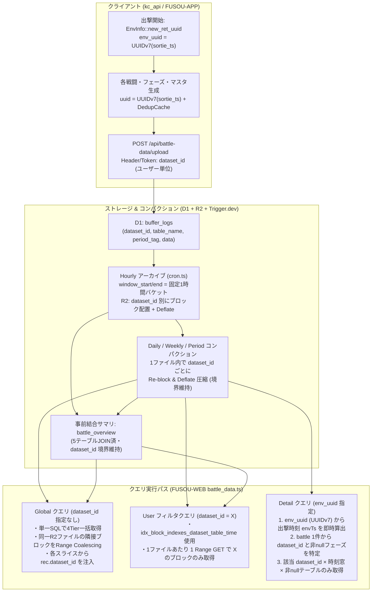

# 戦闘データ取得高速化およびコンパクション・ID設計 調査報告書兼実装計画書

作成日: 2026-10-20  
対象パッケージ: `FUSOU-WEB`, `FUSOU-WORKFLOW`, `fusou-compaction-core`, `fusou-compaction-trigger`, `kc_api`

---

## 1. 背景と目的

現在、戦闘データページ（`/battles`：Overview / Drops / Detail / Advanced Search）におけるデータ取得（Cloudflare R2 + D1 経由のサーバー取得モードおよびローカル AVRO フォルダ読込モード）において、初期表示や詳細モーダル展開時に顕著なレイテンシが発生している。

また、本プロジェクトでは以下のデータ発行・提供モデルを採用・計画している：

1. **`dataset_id`（ユーザー単位で発行）**:
   - 各ユーザーの証跡・アップロード単位（`public_id` / データセットトークン）として発行される。
   - 現在は全ユーザー横断の Global ビュー（`/api/battle-data/global/*`）が主であるが、**将来的に `dataset_id` でフィルタリングしたユーザー単位（あるいは特定 `dataset_id` 指定）のデータ提供・分析機能**を本格提供する。
2. **`env_uuid`（出撃＝母港出撃単位で発行）**:
   - 1回の出撃（Sortie）ごとに1つ発行され、その出撃中に発生した全マス移動（`cells`）・全戦闘（`battle`, `battle_result`, 砲撃・雷撃等の各フェーズ）・出撃時編成スナップショット（`ship`, `slotitem`, `useitem` 等）を束ねるキーとなる。

本ドキュメントでは、**「どこが・なぜ遅いのか」のコードレベルの原因分析**、**`dataset_id` / `env_uuid` の発行仕様を活かしたクエリ・コンパクション設計**、および**各改善施策による定量的な高速化見込みと段階的実装計画**を定義する。

---

## 2. 識別子（ID）発行体系とデータ構造の整理

最適化およびコンパクション設計の前提として、クライアント側（`packages/kc_api/crates/kc-api-database`）からサーバー側（D1 / R2）に至る ID 発行・格納の仕組みを整理する。

### 2.1 各 ID の発行粒度と生成アルゴリズム

| 識別子 | 発行粒度 | 生成箇所・アルゴリズム | 格納場所・特徴 |
| :--- | :--- | :--- | :--- |
| **`dataset_id`** | **ユーザー単位** | クライアント認証 / データセットトークン（`public_id`） | D1 `buffer_logs.dataset_id`, `block_indexes.dataset_id` に格納。<br>**※注意: Avro レコード内部のフィールドには含まれていない（メタデータのみ）。** |
| **`env_uuid`** | **出撃（Sortie）単位** | `EnvInfo::new_ret_uuid` (`models/env_info.rs` L35-50)<br>`Uuid::new_v7(ts)` | **UUID v7**。先頭 48 bit に**出撃開始時刻の Unix Epoch ミリ秒タイムスタンプ**が埋め込まれている。出撃内の全テーブル（`battle.env_uuid`, `cells.env_uuid` 等）が同一値を参照する。 |
| **レコード `uuid`**<br>(`battle.uuid`, `enemy_deck.uuid`, `hougeki_list.uuid` 等) | **戦闘 / エンティティ単位** | `Battle::new_ret_option` (`models/battle.rs`)<br>` register_dedup_list` (`dedup.rs` L45)<br>`Uuid::new_v7(ts)` | **UUID v7**。出撃の `ts: uuid::Timestamp` を引き継いで生成される。また `DedupCache` により、同一出撃内で内容が一致する敵編成・艦船・装備リスト等は同一 UUID に重複排除（Deduplication）される。 |
| **`file_id` / `block_indexes.id`** | **R2 オブジェクト / ブロック単位** | `cron.ts` / `fusou-compaction-trigger` | 1つの `.avro` ファイル内に複数 `dataset_id` のブロックが格納され、`block_indexes` が `(file_id, dataset_id, start_byte, length, start_timestamp, end_timestamp)` を保持する。 |

### 2.2 ID 設計に関する現状の重大な課題と活用機会

1. **【課題】Avro デコード時に `block_indexes.dataset_id` がレコードへ注入されていない**
   - `packages/FUSOU-WEB/src/server/routes/battle_data.ts` (L641-698) の `attachSortieIds` では、出撃境界を判定するために `String(item.rec["dataset_id"] ?? "global")` を参照している。
   - しかし、Avro スキーマ（`Battle`, `Cells` 等）には `dataset_id` カラムが存在せず、`decodeIndexedBlock` (L753-814) でも `row.dataset_id` をデコード結果レコードに付与していない。
   - その結果、**全ユーザーのレコードが `"global"` という単一バケットとして処理され、他ユーザーの戦闘がインターリーブした際に `battle.index`（1出撃内の連番 1, 2, 3...）の増減判定が誤作動し、`sortie_id` が不正確に分割・結合される問題**が起きている。
   - **対策**: `decodeIndexedBlock`（または一括デコード処理）で `block_indexes.dataset_id` を各レコードのメタプロパティ（`dataset_id`）として注入する必要がある。これは将来の `dataset_id` フィルタ提供やレスポンス検証にも不可欠である。

2. **【機会】`env_uuid` が UUID v7 であることを利用した時間範囲の即時特定**
   - UUID v7 の仕様上、`env_uuid`（例: `0198xxxx-xxxx-7xxx-...`）の先頭 12 桁の 16 進数（48 bit）はビッグエンディアンのミリ秒タイムスタンプそのものである。
   - 1回の出撃で生成される全テーブルのレコードは、母港帰投時または出撃終了時に 1 回のバッチアップロード（`POST /api/battle-data/upload`）で同一 `dataset_id` として送信される。
   - したがって、**`env_uuid` さえ分かれば、D1 に一切問い合わせることなく「その出撃がいつ発生したか（`envTs`）」をミリ秒精度で計算でき、さらにアンカーとなる `battle` レコードから `dataset_id` を特定すれば、関連する 30 テーブルの検索対象ブロックを「該当 `dataset_id` × 出撃時刻前後（例: -10分〜+6時間）」のわずか 1〜2 ブロックに絞り込むことができる。**

---

## 3. 現状のボトルネック詳細分析（どこが・なぜ遅いのか）

調査の結果、遅延は単一の原因ではなく、**① サーバー API の直列クエリと過剰スキャン、② R2/Avro デコード処理の非効率、③ コンパクション層の未圧縮・極小ブロック構造と境界バグ、④ フロントエンドの直列初期化**の 4 層で複合的に発生していることが判明した。

---

### 3.1 サーバーサイド（`packages/FUSOU-WEB/src/server/routes/battle_data.ts`）のボトルネック

#### ボトルネック S-1: `/global/overview` における 3 段階直列ウォーターフォールと $O(N \times M)$ フィルタ
- **該当箇所**: `battle_data.ts` L2264-2378 (`/global/overview`), L701-743 (`matchesRecordFilter`)
- **現状の挙動**:
  1. **第1波（並列）**: `battle` (最大200ブロック/20,000件), `cells` (200ブロック), `battle_result` (200ブロック), `mst_ship` を 내부 `/global/records` 呼び出しで取得。
  2. **第2波（第1波完了待ち・直列）**: 取得した `battle` からユニークな `e_deck_id` 配列（数百〜数千件）を抽出し、`filter_json={"uuid": deckIds}` をクエリ文字列に載せて `enemy_deck` を 최대 400 ブロックスキャン。
  3. **第3波（第2波完了待ち・直列）**: 取得した `enemy_deck` から `ship_ids` 配列を抽出し、`filter_json={"uuid": shipGroupIds}` を指定して `enemy_ship` を最大 400 ブロックスキャン。
- **何がどう悪いのか**:
  - **3 段階の直列待ち**: D1 クエリ + R2 Range GET + Avro デコードのサイクルを直列に 3 往復実行している。
  - **$O(N \times M)$ の線形探索**: `matchesRecordFilter` (L718-720) が `Array.isArray(expected)` に対して毎回 `expected.includes(actual)` を実行している。たとえば `enemy_ship` 40,000 レコード × `shipGroupIds` 1,500 件 ＝ **最大 6,000 万回の文字列比較**が 1 リクエスト内で発生する。
  - **キャッシュヒット率の低下**: `deckIds` や `shipGroupIds` をそのまま URL クエリパラメータ `filter_json` に入れているため、新しい戦闘が 1 件増えるたびに `filterHash` が変わり、サブクエリの KV / Cache API がミスする。

#### ボトルネック S-2: `/global/records` 内部の 4 Tier 直列 D1 クエリと重複メタデータ照会
- **該当箇所**: `battle_data.ts` L1877-2102 (`/global/records`)
- **現状の挙動**:
  - `/global/records` が呼ばれるたびに、毎回以下を実行している：
    1. `resolveAllowedPeriodTagsForRecords`（D1 または KV 照会）
    2. `SELECT DISTINCT period_tag, table_version FROM block_indexes ...`（D1 クエリ）
    3. `tier` 未指定時、`for (const tier of ["period", "weekly", "daily", "hourly"])` の **`for...of` ループで 4 回直列に `await fetchBlocks(tier)` を実行** (L2096-2101)。
    4. 4 つの Tier から最大 `limitBlocks`（200〜400行）ずつ取得した後、`mergeTierRows` (L2036-2079) で単に `start_timestamp DESC` にソートして先頭 `limitBlocks` 件を切り出している。
- **何がどう悪いのか**:
  - `/global/overview` 1 回のリクエスト（内部で `/global/records` を 6 回呼ぶ）で、キャッシュミス時に **計 30 回以上の D1 クエリ（うち 24 回が 4 Tier 直列ループ）** が発行される。
  - `mergeTierRows` は結局 `start_timestamp DESC` で上位 `limitBlocks` 件を採るだけなので、Tier ごとに 4 回直列に D1 を叩く必要がまったくない。1 本の SQL（`ORDER BY start_timestamp DESC, CASE compaction_tier ... LIMIT ?`）で 1 回で取得可能である。

#### ボトルネック S-3: 同一 R2 ファイルに対する数百回の個別 Range GET と Avro スキーマ毎回パース
- **該当箇所**: `battle_data.ts` L753-814 (`decodeIndexedBlock`), L2152-2173 (`rows.map`)、および `packages/fusou-compaction-core/src/avro.ts` L553-556, L662-679
- **現状の挙動**:
  - `block_indexes` は `dataset_id`（ユーザー）ごとに 1 行作成されるが、コンパクション後の物理ファイル（`file_path`）は **同一の `.avro` ファイル内に全ユーザーのブロックを連続配置**している。
  - Global クエリ（`dataset_id` 指定なし）で 200 行の `block_indexes` を読む際、`rows.map(row => decodeIndexedBlock(...))` により、**同じ R2 オブジェクトに対して最大 200〜400 回の個別 `bucket.get(filePath, { range: { offset, length } })` を並列発火**している。
  - さらに `decodeIndexedBlock` 内では、R2 ヘッダバイト列（`headerBytes`）こそ `headerCache` で共有しているものの、**`parseOcfHeader(headerBytes)` と `decodeAvroDataBlocks` 内の `parseHeaderForDecoder(header)`（Avro スキーマ JSON の `JSON.parse` と名前解決マップ構築）を全ブロック（200〜400回）毎回実行**している。
- **何がどう悪いのか**:
  - Cloudflare Workers における同一 R2 オブジェクトへの数百並列 Range GET は I/O キュー待ちとオーバーヘッドを引き起こす。
  - スキーマ JSON パースの 200〜400 回重複実行により、Workers の CPU 時間（特に `mst_ship` や `battle` などフィールド数が多いスキーマ）が浪費される。

#### ボトルネック S-4: `/detail` における無条件 31 テーブル × 120 ブロックの全件ファンアウト
- **該当箇所**: `battle_data.ts` L2475-2720 (`/detail`), L912-1044 (`fetchBattleEnvBundleInternal`)
- **現状の挙動**:
  - `/api/battle-data/detail?env_uuid=...&battle_index=...` が呼ばれると：
    1. まず `battle` テーブルを `filter_json={"env_uuid":..., "index":...}` で最新 120 ブロック検索。
    2. その後、`Promise.all` で **30 個の内部テーブル（`cells`, `battle_result`, 母港環境 6 テーブル `env_info`/`ship`/`slotitem`/`useitem`/`deck_port`/`basic`, 戦闘フェーズ 22 テーブル `hougeki_list`/`raigeki`/`kouku` 等）に対して一斉に `/global/records?limit_blocks=120` を呼び出す**。
- **何がどう悪いのか**:
  - **空フェーズの無駄な検索**: 通常の昼戦では基地航空隊（`air_base_*`）、友軍艦隊（`friendly_*`）、夜戦（`midnight_*`）、支援艦隊（`support_*`）等の大半のフィールドは `null` である。ローカル Worker (`packages/FUSOU-WEB/src/features/battles/local-worker/session.ts` L558) では `hasReference(battle[phaseField])` が `true` のテーブルだけを読んでいるのに、サーバー `/detail` は **`null` であっても無条件に 22 フェーズすべてに D1 + R2 クエリを投げている**。
  - **`dataset_id` と時刻による絞り込みの欠如**: アンカーとなる `battle` レコードが取得できた時点で、その出撃の `dataset_id` とタイムスタンプ（および `env_uuid` の UUIDv7 タイムスタンプ）は確定している。にもかかわらず、残り 30 テーブルを「全ユーザー（`dataset_id` 指定なし）の最新 120 ブロック」から毎回フルスキャンしている。
  - これにより、**1 回の戦闘詳細表示で最大 31 テーブル × 4 Tier = 124 回の D1 クエリと、最大 3,720 ブロック分の R2 読み込み**が発生し、さらに 120 ブロックより古い戦闘は詳細が取得できない（Not Found になる）問題も抱えている。

---

### 3.2 データコンパクション層のボトルネックと設計上の問題

#### ボトルネック C-1: `Codec::Null`（無圧縮）かつ極小ブロックの単純連結
- **該当箇所**:
  - クライアントエンコード: `packages/kc_api/crates/kc-api-database/src/encode.rs` L18-24 (`Writer::with_codec(..., Codec::Null)`)
  - コンパクション結合: `packages/fusou-compaction-core/src/index.ts` L135-168 (`mergeAvroOCFWithBoundaries`)
  - メタデータ記録: `packages/FUSOU-WORKFLOW/src/cron.ts` L529, `packages/fusou-compaction-trigger/src/index.ts` L280 (`compression_codec: 'deflate'` とハードコード)
- **何がどう悪いのか**:
  - クライアントは 1 回のアップロード（1 出撃＝数レコード）ごとに `Codec::Null`（無圧縮）で OCF ブロックを生成する。
  - `hourly` / `daily` / `weekly` / `period` の全コンパクションで使用されている `mergeAvroOCFWithBoundaries` は、**各チャンクの OCF ヘッダを剥がして 16 バイトの Sync Marker を書き換えてバイト連結しているだけで、内部の Avro データブロックの再ブロック化（Re-blocking）も圧縮（Deflate）も一切行っていない**（D1 の `archived_files.compression_codec` には `'deflate'` と誤記されているが実態は無圧縮 `'null'`）。
  - その結果、コンパクション後のファイルであっても：
    1. **ファイルサイズが本来の 4〜6 倍に肥大化**しており、R2 からのネットワーク転送量・メモリ確保量が大きい。
    2. 1 つの `dataset_id` 境界スライスの中に、**1〜数レコードしか入っていない極小 Avro データブロックが何百個も数珠繋ぎ**になっており、各ブロックごとに Sync Marker (16B) + Block Count/Size VLong (2〜4B) のオーバーヘッドとデコーダループの反復が発生する。

#### ボトルネック C-2: Global クエリと `dataset_id` フィルタのトレードオフ未解消
- **該当箇所**: `packages/FUSOU-WORKFLOW/src/cron.ts` L419-578, `packages/fusou-compaction-trigger/src/index.ts` L224-315
- **現状の挙動と評価**:
  - 現在のコンパクションは、同一テーブルのチャンクを **`dataset_id` ごとにグルーピングして連結**し、1 ファイルにつき `dataset_id` の数だけ `block_indexes` 行（`start_byte`, `length`）を作成している。
  - **良い点（維持すべき性質）**: 将来 `dataset_id = ?` でフィルタリングしてデータを提供する際、**1 つのコンパクション済みファイルにつき該当ユーザーの連続バイト領域だけを 1 回の Range GET でピンポイントに取得できる**。
  - **悪い点（改善すべき性質）**: Global クエリ（`dataset_id` フィルタなし）のときに、同じファイル内の別ユーザーの `block_indexes` 行をバラバラに Range GET してしまい（ボトルネック S-3）、かつ `hourly` ファイルが未コンパクションのまま残っていると同一ユーザーでもブロックが細切れになる。

#### ボトルネック C-3: `hourly` → `daily` コンパクションにおける「00:00 UTC 日跨ぎブロック」の孤立・消失バグ
- **該当箇所**:
  - `packages/FUSOU-WORKFLOW/src/cron.ts` L552-554 (`window_start_ms: block.startTimestamp, window_end_ms: block.endTimestamp`)
  - `packages/fusou-compaction-trigger/src/compaction-tasks.ts` L34-37 (`dayStart`, `dayEnd`)
  - `packages/FUSOU-WORKFLOW/src/internal_compaction.ts` L162-173 (`WHERE bi.window_start_ms >= ? AND bi.window_end_ms <= ?`), L1180-1182 (`DELETE FROM block_indexes WHERE file_id IN (...)`)
- **何がどう悪いのか**:
  - `cron.ts` が `hourly` アーカイブを作成する際、`block_indexes` の `window_start_ms` と `window_end_ms` に固定の 1 時間バケット境界ではなく、**そのユーザーのバッファログの実レコード最小・最大タイムスタンプ（`block.startTimestamp`, `block.endTimestamp`）**をそのまま入れている。
  - 一方、`compactDaily` は `window_start_ms >= 00:00:00.000 AND window_end_ms <= 23:59:59.999` で検索する。
  - もしある `hourly` ファイル内のデータセットが **UTC 00:00（日本時間 09:00）を跨ぐログ**（例: `23:55 UTC` 〜 `00:05 UTC`）を含んでいた場合、そのブロックは前日の `daily` にも当日の `daily` にも永遠にマッチしない（`hourly` Tier に一生取り残される）。
  - さらに深刻なことに、同じ `hourly` ファイル内にいた**別ユーザーのブロック**が `daily` コンパクションにマッチして処理されると、クリーンアップ処理 (`cleanup-consumed-sources`) が **`DELETE FROM block_indexes WHERE file_id = ?` でファイル単位の削除を行うため、日跨ぎで未コンパクションだったユーザーのインデックスと R2 ファイルが丸ごと消滅（データロスト）する**。

#### ボトルネック C-4: Overview / Drops 表示のための 5 テーブル動的 JOIN
- **現状の挙動**:
  - 戦闘一覧（Overview）やドロップ一覧（Drops）を表示するだけでも、毎回 `battle`, `cells`, `battle_result`, `enemy_deck`, `enemy_ship` の 5 つの巨大テーブルを R2 から取得・デコードしてメモリ上で JOIN している。
  - しかし一覧表示に実際に必要なのは、1 戦闘あたりわずか 12 個程度のスカラ/小配列フィールド（`uuid`, `env_uuid`, `dataset_id`, `index`, `timestamp`, `maparea_id`, `mapinfo_no`, `cell_id`, `f_formation`, `e_formation`, `win_rank`, `drop_ship_id`, `enemy_ship_mst_ids`）のみである。

---

### 3.3 フロントエンド・ローカル AVRO 読込（`packages/FUSOU-WEB/src`）のボトルネック

#### ボトルネック F-1: `BattlesDashboard.tsx` におけるマスタデータ取得と戦闘データ取得の直列化
- **該当箇所**: `packages/FUSOU-WEB/src/components/battles/BattlesDashboard.tsx` L435-479 (`loadRepositoryData`)
- **何がどう悪いのか**:
  - `await loadMasterMaps()`（`/api/master-data/json?table_name=mst_ship` および `mst_slotitem` の 2 本の JSON フェッチ・パース）が**完了するのを待ってから** `repository.getOverview()` / `repository.getDrops()` を呼び出している。
  - サーバー取得モード（`R2BattleRepository`）ではサーバー側で艦名解決まで行っているためクライアントの `masterShips` は不要であり、ローカルモードでもマスタ取得と AVRO 読込は完全に並列化可能である。

#### ボトルネック F-2: ローカル AVRO ディレクトリスキャンのメインスレッド直列 I/O
- **該当箇所**: `packages/FUSOU-WEB/src/features/battles/local-worker/manifest-scanner.ts` L92-198 (`scanDirectory`, `readEmbeddedTableVersion`)
- **何がどう悪いのか**:
  - ユーザーがローカルの AVRO フォルダを選択した際、メインスレッド上で全 37 テーブルのディレクトリを再帰走査し、すべての `.avro` ファイルに対して **1 ファイルずつ直列に `await child.getFile()` → `await file.slice(0, 65536).arrayBuffer()`** を実行して `table_version` を抽出している。
  - ファイル数が数百〜数千個ある場合、Web Worker が起動する前の段階で数秒間 UI がブロック・遅延する。

#### ボトルネック F-3: `LocalWorkerSession.overview` の直列テーブル読込
- **該当箇所**: `packages/FUSOU-WEB/src/features/battles/local-worker/session.ts` L387-436
- **何がどう悪いのか**:
  - `loadOptionalRows` は対象テーブルの全レコードをデコードしてメモリキャッシュに載せる実装であるにもかかわらず、`[battle, cells, battle_result]` を読んだ後に `await enemy_deck`、その後に `await enemy_ship` を直列に呼び出している。5 テーブルを最初から `Promise.all` で読めば待ち時間を短縮できる。

---

## 4. `dataset_id`（ユーザー単位）と `env_uuid`（出撃単位）を軸としたアーキテクチャ設計

将来の **`dataset_id` フィルタ付きデータ提供** と **Global 横断データ提供** の双方を最高速で両立するためのデータ構造・インデックス・コンパクション設計を以下に示す。



### 4.1 `dataset_id` フィルタと Global クエリを両立するハイブリッド・ブロックレイアウト

コンパクション後の R2 ファイル構造は、以下の**「ファイル内 `dataset_id` パーティション + ブロック再構築（Re-blocking & Deflate）」**を採用する。

1. **物理レイアウト（R2 `.avro` ファイル内）**:
   - 1 つのコンパクションファイル（`hourly` / `daily` / `weekly` / `period`）の中で、データは **`dataset_id` 単位で連続した 1 つ（または大型の少数）の Deflate 圧縮 Avro データブロック**に再構築（Re-block）して配置する。
   - これにより、D1 `block_indexes` には引き続き `(file_id, dataset_id, start_byte, length, record_count, start_timestamp, end_timestamp)` が 1 ユーザー 1 行で記録される。
2. **`dataset_id` 指定クエリ時の動作（将来機能・個人データ提供・`/detail` 2段目）**:
   - D1 で `WHERE table_name = ? AND dataset_id = ?`（複数指定時は `IN (...)`）を検索。
   - 各 Tier ファイルにつき **該当ユーザーのバイト範囲 `[start_byte, start_byte + length - 1]` だけを 1 回の R2 Range GET で取得**できる。他ユーザーのデータを 1 バイトも読む必要がない。
3. **Global クエリ時の動作（全体 Overview / Drops / 全体検索）**:
   - D1 で `dataset_id` 条件なしで上位ブロックを取得。
   - **Range Coalescing（範囲結合）**: 同一 `file_id` に属する複数の `block_indexes` 行について、R2 へは `[min(start_byte), max(start_byte + length) - 1]`（またはギャップが 64KB 以内の連続チャンク）として **ファイルあたり 1 回の Range GET** に束ねる。
   - メモリ上で各 `block_indexes` 行の相対オフセット `[row.start_byte - minOffset, ...]` ごとに切り出してデコードし、その際 **`row.dataset_id` を各デコード済みレコードに注入**する。

### 4.2 `env_uuid`（UUID v7）を活用した `/detail` の O(1) アンカー解決

`env_uuid` から出撃のミリ秒タイムスタンプを抽出するヘルパーを導入する：

```typescript
/**
 * UUID v7 の先頭 48 bit から Unix Epoch ミリ秒タイムスタンプを抽出する。
 * UUID v7 でない場合は null を返す。
 */
export function extractTimestampFromUuidV7(uuidStr: string): number | null {
  const hex = uuidStr.replace(/-/g, "");
  if (hex.length !== 32) return null;
  const version = parseInt(hex[12], 16);
  if (version !== 7) return null;
  const tsHex = hex.slice(0, 12);
  const ts = Number(BigInt(`0x${tsHex}`));
  return Number.isFinite(ts) && ts > 1577836800000 ? ts : null; // 2020-01-01 以降
}
```

**`/detail?env_uuid=...&battle_index=...` の新しい解決フロー**:
1. **Step 1（アンカー `battle` の特定）**:
   - `env_uuid` から `envTs = extractTimestampFromUuidV7(envUuid)` を算出。
   - クエリパラメータに `dataset_id` があればそれも条件に加え、`envTs` が得られた場合は `block_indexes` の検索に時間窓条件（例: `start_timestamp <= envTs + 12時間 AND end_timestamp >= envTs - 1時間`）を付与して `battle` を検索する。
   - これにより、**最新 120 ブロックよりも遥かに古い過去の出撃であっても、数ミリ秒で確実にアンカー `battle` ブロックを特定できる**。
2. **Step 2（`dataset_id`・出撃時間窓・非 null フェーズによる最小限フェッチ）**:
   - 見つかった `battle` レコードが属していた `block_indexes` 行から **`anchorDatasetId = row.dataset_id`** および **`anchorPeriodTag = row.period_tag`**、**`battleTs = battle.timestamp`** を取得する。
   - `battle` レコード内の参照フィールド（`f_nowhps`, `midnight_hougeki`, `air_base_air_attacks`, `support_attack`, `opening_taisen`, `hougeki`, `raigeki` 等）を検査し、**実際に値が存在する（非 null の）フェーズテーブルのみ**を抽出する（通常 22 テーブル中 3〜6 テーブルのみ）。
   - 抽出したテーブル＋`cells`＋`battle_result`＋母港環境 6 テーブル（計 10〜13 テーブル）に対し、**`dataset_id = anchorDatasetId` かつ時間窓 `[min(envTs, battleTs) - 1h, max(envTs, battleTs) + 6h]`** を指定して取得する。
   - さらに同一 R2 アップロードバッチで保存されたこれらのテーブルは、同じ Tier・同じ時間窓の 1〜2 個のブロックに必ず収まっているため、**1 テーブルあたりスキャンするブロック数は 120 個 → 1〜2 個（約 98% 削減）**となる。

---

## 5. 段階的実装計画（フェーズ別タスク詳細）

### Phase 0: サーバークエリ・R2 I/O・キャッシュの即効改善（スキーマ変更なし）

コンパクション済みデータの再生成を待たずに、コード変更のみで即座に大幅な高速化を達成するフェーズ。

#### Task 0-1: `/global/records` の 4 Tier 直列 D1 クエリを単一 SQL に統合
- **対象ファイル**: `packages/FUSOU-WEB/src/server/routes/battle_data.ts` (L1885-2105)
- **変更内容**:
  - `for (const tier of ["period", "weekly", "daily", "hourly"])` の直列ループを廃止。
  - `tier` 未指定時は `compaction_tier IN ('period', 'weekly', 'daily', 'hourly')` を 1 回の D1 クエリで取得する：
    ```sql
    SELECT bi.id, bi.file_id, bi.dataset_id, bi.table_name, bi.table_version, bi.period_tag,
           bi.compaction_tier, bi.start_byte, bi.length, bi.record_count,
           bi.start_timestamp, bi.end_timestamp, af.file_path
    FROM block_indexes bi
    JOIN archived_files af ON bi.file_id = af.id
    WHERE bi.table_name = ?
      AND bi.period_tag IN (...)
      AND bi.table_version = ?
      -- 任意: AND bi.dataset_id = ?
      -- 任意: AND bi.end_timestamp >= ? AND bi.start_timestamp <= ?
    ORDER BY bi.start_timestamp DESC,
             CASE bi.compaction_tier
               WHEN 'period' THEN 0
               WHEN 'weekly' THEN 1
               WHEN 'daily' THEN 2
               ELSE 3
             END ASC
    LIMIT ?
    ```
  - `SELECT DISTINCT period_tag, table_version` のメタデータクエリ結果をメモリ LRU + KV に 60 秒キャッシュし、サブクエリ間で共有する。

#### Task 0-2: R2 Range Coalescing（同一ファイル Range 結合）と Avro スキーマキャッシュ + `dataset_id` 注入
- **対象ファイル**:
  - `packages/fusou-compaction-core/src/avro.ts` (L553-556, L662-679)
  - `packages/FUSOU-WEB/src/server/routes/battle_data.ts` (L753-814, L2152-2173)
- **変更内容**:
  1. **`PreparedAvroDecoderContext` の導入 (`avro.ts`)**:
     - `parseOcfHeader(headerBytes)` と `parseHeaderForDecoder(header)`（スキーマ JSON パースおよび `namedSchemas` 構築）を 1 回だけ実行してオブジェクトとして返す `prepareAvroDecoderContext(headerBytes)` を追加し、`decodeAvroDataBlocksWithContext(bodyBytes, context)` で再利用できるようにする。
  2. **R2 Range Coalescing (`battle_data.ts`)**:
     - 取得対象の `block_indexes` 行配列を `file_path` ごとにグルーピングし、`start_byte` 昇順にソートする。
     - 同一 `file_path` 内で隣接またはギャップが `65,536` バイト以下のブロック群を 1 つの結合 Range `[groupStart, groupEnd]` にまとめ、**ファイル（または連続領域）あたり 1 回の `bucket.get(filePath, { range })`** でバッファを取得する。
     - 取得したバッファから各 `row` の部分スライス `subarray(row.start_byte - groupStart, ...)` を切り出して `decodeAvroDataBlocksWithContext` に渡す。
  3. **`dataset_id` の注入**:
     - デコードされた各レコード `rec` に対し、`rec.dataset_id = row.dataset_id` を付与する。これにより `attachSortieIds` の出撃境界判定バグを修正し、同時に `dataset_id` フィルタ時の整合性を保証する。

#### Task 0-3: `matchesRecordFilter` の `Set` 化と内部関数直接呼び出し
- **対象ファイル**: `packages/FUSOU-WEB/src/server/routes/battle_data.ts` (L701-743, L2264-2378)
- **変更内容**:
  - クエリ開始時に `filter` オブジェクト内の配列値をすべて `Set<string>` に変換する `compileRecordFilter(filter)` を作成し、1 レコードあたりのフィルタ判定を $O(M)$ から **$O(1)$** に高速化する。
  - `/global/overview` や `/detail` が自分自身の Hono ルートを `fetchBattleSubpath`（HTTP Request オブジェクト生成＋URL エンコード＋ルータ再通過）で呼んでいる箇所を、内部サービス関数 `queryBattleRecordsInternal(env, params, sharedContext)` の直接呼び出しに置き換え、長大な `filter_json` URL 生成と重複メタデータクエリを排除する。

---

### Phase 1: `/detail` の UUIDv7 + `dataset_id` 最適化およびフロントエンド・ローカル AVRO 高速化

#### Task 1-1: `/detail` のアンカー駆動・非 null テーブル選択フェッチ化
- **対象ファイル**: `packages/FUSOU-WEB/src/server/routes/battle_data.ts` (L912-1044, L2475-2720)
- **変更内容**:
  - 4.2 節で設計した `extractTimestampFromUuidV7(envUuid)` を実装。
  - アンカー `battle` 取得後、以下の最適化を適用：
    1. **非 null フェーズのみの選択**: `LocalWorkerSession.detail` (`packages/FUSOU-WEB/src/features/battles/local-worker/session.ts` L550-563) と同様の `hasReference(battle[field])` チェックを導入し、`null` または空配列の戦闘フェーズテーブルへのクエリを完全にスキップする。
    2. **`dataset_id` + タイムスタンプ窓によるピンポイント絞り込み**: アンカー `battle` から判明した `dataset_id` と `timestamp`（および `envTs`）を用い、残りのテーブル検索時に `datasetId: anchorDatasetId`, `fromMs: minTs - 3600_000`, `toMs: maxTs + 21600_000`, `limitBlocks: 4` を指定する。
    3. **重複呼び出しの排除**: 現在 `/detail` 内で `cells` が 2 回（L2552 の一括 `Promise.all` と L2607 の `resolveMapIdFromCells`）呼ばれている重複を排除し、第1波の結果を再利用する。

#### Task 1-2: フロントエンド `BattlesDashboard.tsx` の並列ロード化
- **対象ファイル**: `packages/FUSOU-WEB/src/components/battles/BattlesDashboard.tsx` (L435-479)
- **変更内容**:
  - `loadMasterMaps()` と `repository.getOverview()` / `repository.getDrops()` を直列ではなく `Promise.all` で並列実行する。
  - R2（サーバー）モード時は、Overview / Drops の初期描画をマスタデータの完了を待たずに即座に開始する（サーバーレスポンスに `enemy_ships` 等の名称が含まれているため）。

#### Task 1-3: ローカル AVRO スキャンの並列化・Worker オフロードと `LocalWorkerSession` 並列化
- **対象ファイル**:
  - `packages/FUSOU-WEB/src/features/battles/local-worker/manifest-scanner.ts` (L92-198)
  - `packages/FUSOU-WEB/src/features/battles/local-worker/session.ts` (L387-436)
- **変更内容**:
  1. `manifest-scanner.ts`:
     - テーブル単位のディレクトリ走査を `Promise.all` で並列化する。
     - **テーブル単位の `table_version` キャッシュ**: 同一テーブルフォルダ内の `.avro` ファイル群（例: `battle/*.avro`）は同一スキーマバージョンを持つため、フォルダ内の先頭 1 ファイルのヘッダから `table_version` を読んだら、同フォルダ内の残りファイルは `file.slice(0, 64KB)` の読み込みをスキップする（または `FileSystemDirectoryHandle` 自体を Worker に `postMessage` で渡してバックグラウンドスキャンする）。
  2. `session.ts`:
     - `LocalWorkerSession.overview` で `battle`, `cells`, `battle_result`, `enemy_deck`, `enemy_ship` の 5 テーブルを最初から単一の `Promise.all` で並列デコードする。

---

### Phase 2: データコンパクション改善（時間窓バグ修正・Re-blocking + Deflate 圧縮・事前結合サマリ）

#### Task 2-1: `hourly` コンパクションの `window_start_ms` / `window_end_ms` バケット固定化（データ消失バグ修正）
- **対象ファイル**: `packages/FUSOU-WORKFLOW/src/cron.ts` (L380-560)
- **変更内容**:
  - `cron.ts` で `block_indexes` に書き込む `window_start_ms` と `window_end_ms` を、レコードの偶発的な最小/最大時刻（`block.startTimestamp` / `block.endTimestamp`）ではなく、**アーカイブ対象の 1 時間バケット境界（例: `hourBucketStartMs` 〜 `hourBucketEndMs`）に統一**する（あるいは日跨ぎのバッファログを UTC 日付境界 `00:00:00.000` で分割してブロック化する）。
  - 個々のレコードの正確な最小・最大タイムスタンプは、既存の `start_timestamp` / `end_timestamp` カラムに引き続き保持する。
  - また `internal_compaction.ts` (L1175-1190) の `cleanup-consumed-sources` において、万一ファイル内に未処理の `block_indexes` 行が残っている場合は `archived_files` を削除しないガード条件を追加する。

#### Task 2-2: `dataset_id` 境界維持型 Re-blocking + Raw Deflate 圧縮の導入
- **対象ファイル**:
  - `packages/fusou-compaction-core/src/avro.ts`
  - `packages/fusou-compaction-core/src/index.ts` (`mergeAvroOCFWithBoundaries`)
  - `packages/fusou-compaction-trigger/src/index.ts`
- **変更内容**:
  - `mergeAvroOCFWithBoundaries` にオプション `{ reblock: true, codec: 'deflate' | 'null' }` を追加する：
    1. 同一 `dataset_id` に属する複数の入力チャンクから、全データブロックのレコード件数（`totalCount`）と非圧縮シリアライズ済みレコードバイト列を結合する（Avro バイナリエンコード済みのレコード本体は再シリアライズ不要で、各入力ブロックの `[ count (VLong), size (VLong), rawPayload, syncMarker (16B) ]` から `rawPayload` 部分をそのまま連結するだけで 1 つの大きなブロックのペイロードを作れる！ **※デコード＆再エンコードすら不要で超高速**）。
    2. 連結した `rawPayload` に対して `CompressionStream('deflate-raw')`（または Node `zlib.deflateRawSync`）で Raw Deflate 圧縮を適用する。
    3. OCF ヘッダ内のメタデータ `avro.codec` を `'deflate'` に設定し、`dataset_id` ごとに **1 つの圧縮済み Avro データブロック `[ encodeVLong(totalCount), encodeVLong(compressedBytes.length), compressedBytes, syncMarker ]`** として出力する。
  - **なぜこれが革新的か**:
    - **CPU コスト極小**: レコードの中身を JSON/オブジェクトにデコードして書き直す必要がなく、無圧縮 OCF ブロックのレコードバイト列をそのままスライス結合して一括 `deflateRaw` するだけで済む。
    - **デコードの互換性**: `packages/fusou-compaction-core/src/avro.ts` L562-564 の `decompressBlockBytes` は既に `codec === 'deflate'`（`DecompressionStream('deflate-raw')`）に完全対応している！
    - **`dataset_id` 境界の完全維持**: 1 つのコンパクションファイル内で `dataset_id` ごとに 1 つの圧縮ブロックになるため、`block_indexes` の `(dataset_id, start_byte, length)` による 1 Range GET 抽出がそのまま機能し、かつ R2 ファイルサイズと転送量が **70〜85% 削減**される。

#### Task 2-3: Overview / Drops 用の事前結合サマリテーブル（`battle_overview`）の生成
- **対象ファイル**:
  - `packages/FUSOU-WORKFLOW/src/cron.ts`
  - `packages/fusou-compaction-trigger/src/index.ts`
  - `packages/FUSOU-WEB/src/server/routes/battle_data.ts` (`/global/overview`, `/global/drops`)
- **変更内容**:
  - `hourly` アーカイブ時（またはコンパクション時）に、同一バッチ内の `battle`, `cells`, `battle_result`, `enemy_deck`, `enemy_ship` を結合した軽量 Avro テーブル **`battle_overview`** を生成し、通常テーブルと同様に `dataset_id` ごとのブロック境界を持たせて R2 + `block_indexes` (`table_name = 'battle_overview'`) に登録する。
  - **含めるフィールド**:
    - `uuid`, `env_uuid`, `dataset_id`, `index`, `timestamp`, `midnight_timestamp`
    - `maparea_id`, `mapinfo_no`, `cell_id`, `f_formation`, `e_formation`
    - `win_rank`, `drop_ship_id`, `e_deck_id`, `enemy_ship_mst_ids` (`array<int>`)
  - **効果**:
    - Global の `/global/overview` および `/global/drops`、ならびに**将来の `dataset_id` 指定 Overview / Drops** の両方が、**5 テーブル 3 段階ウォーターフォールから「`battle_overview` 1 テーブルの 1 回読み取り」に短縮**される。
    - 既存期間のデータについてはフォールバックとして従来の 5 テーブル結合（Phase 0 で高速化済み）を残すことで、ダウンタイムなしで段階移行できる。

---

### Phase 3: 将来の `dataset_id` フィルタデータ提供に向けた D1 インデックス・API 拡張

#### Task 3-1: D1 `block_indexes` への複合インデックス追加
- **対象**: `packages/FUSOU-WORKFLOW/migrations/`（新規マイグレーション追加）
- **現状のインデックス**:
  - `idx_block_indexes_lookup (table_name, period_tag, start_timestamp, end_timestamp)`
  - `idx_block_indexes_tier_lookup (table_name, compaction_tier, period_tag, window_start_ms, window_end_ms)`
  - `idx_block_indexes_dataset (dataset_id)`（単一カラムのみ）
- **追加するインデックス**:
  ```sql
  -- 1. dataset_id フィルタ付きクエリ用（ユーザー別データ提供・/detail の2段目フェッチ用）
  CREATE INDEX IF NOT EXISTS idx_block_indexes_dataset_table_time
    ON block_indexes(dataset_id, table_name, period_tag, start_timestamp DESC);

  -- 2. Global クエリの単一SQL 4Tier一括取得用（table_version + start_timestamp DESC カバリング）
  CREATE INDEX IF NOT EXISTS idx_block_indexes_global_time
    ON block_indexes(table_name, table_version, period_tag, start_timestamp DESC, compaction_tier);
  ```

#### Task 3-2: API クエリパラメータとキャッシュキーへの `dataset_id` 正式組込
- **対象ファイル**:
  - `packages/FUSOU-WEB/src/server/routes/battle_data.ts`
  - `packages/FUSOU-WEB/src/features/battles/repository/r2-repository.ts`
- **変更内容**:
  - `/global/overview`, `/global/drops`, `/global/records`, `/detail`（または新設する `/dataset/:dataset_id/*` エンドポイント）で `dataset_id` パラメータを一貫して受け取れるように整備する。
  - `dataset_id` が指定された場合：
    - D1 クエリが `idx_block_indexes_dataset_table_time` を使用し、該当ユーザーのブロックのみを即座に抽出する。
    - KV / Edge Cache キーに `dataset_id` を含め、ユーザー別ビューもエッジキャッシュ可能にする。

---

## 6. 期待される改善効果（定量見積もり）

各フェーズ適用前後のパフォーマンス指標の比較見積もりを以下に示す（キャッシュミス時＝コールドフェッチ時のサーバー処理およびローカル読込）。

### 6.1 `/api/battle-data/global/overview`（および Drops）

| 指標 | 現状 (Before) | Phase 0 適用後 (即効改善) | Phase 2 適用後 (Re-block + `battle_overview`) | 改善率 (最終) |
| :--- | :--- | :--- | :--- | :--- |
| **直列フェッチ段数** | 3 段階 (Battle → Deck → Ship) | 3 段階（内部直接呼出・Set化） | **1 段階 (`battle_overview` のみ)** | **-67% (1往復化)** |
| **D1 クエリ発行数** | 25〜30 回 (うち 20 回が直列) | **5〜6 回 (直列 3 回)** | **1〜2 回** | **約 93% 削減** |
| **R2 Range GET 回数** | 400〜1,000 回 (ブロック個別) | **5〜25 回 (ファイル単位結合)** | **1〜4 回** | **約 99% 削減** |
| **R2 転送データ量** | 約 8〜25 MB (無圧縮・5テーブル) | 約 8〜25 MB | **約 0.3〜1.2 MB (Deflate・サマリ)** | **約 95% 削減** |
| **Avro スキーマ JSON.parse** | 600〜1,200 回 | **5 回 (テーブルあたり1回)** | **1 回** | **約 99.8% 削減** |
| **フィルタ比較計算量** | $O(N \times M)$ (最大数千万回) | **$O(N)$ (`Set.has`)** | **フィルタ不要 (事前結合済)** | **$O(1)$ 化** |
| **想定応答時間 (Cold)** | **2,500 〜 6,000 ms** | **600 〜 1,200 ms** | **120 〜 300 ms** | **約 10〜20 倍高速化** |

### 6.2 `/api/battle-data/detail?env_uuid=...`（戦闘詳細モーダル）

| 指標 | 現状 (Before) | Phase 0 + Phase 1 適用後 (`env_uuid` UUIDv7 + `dataset_id` アンカー + 非null選択) | 改善率 |
| :--- | :--- | :--- | :--- |
| **検索対象テーブル数** | 31 テーブル固定 (空フェーズも全検索) | **10〜14 テーブル (非 null フェーズのみ)** | **約 60% 削減** |
| **1テーブルあたり検索ブロック数** | 最大 120 ブロック (全ユーザー横断) | **1〜2 ブロック (`dataset_id` × `envTs` 時間窓)** | **約 98% 削減** |
| **合計スキャンブロック数** | 最大 3,720 ブロック | **10〜25 ブロック** | **約 99.3% 削減** |
| **D1 クエリ発行数** | 約 124 回 (31テーブル × 4 Tier) | **2 回 (1. アンカー `battle` 特定 + 2. 対象テーブル一括 `IN (...)` 取得)** | **約 98% 削減** |
| **過去の戦闘 (120ブロック以前)** | 取得不可 (404 Not Found) | **期間内すべて O(1) で取得可能 (`env_uuid` タイムスタンプ直引き)** | **機能制限解消** |
| **想定応答時間 (Cold)** | **3,000 〜 8,000 ms** | **150 〜 400 ms** | **約 15〜20 倍高速化** |

### 6.3 将来の `dataset_id` フィルタ提供時（特定ユーザーの戦闘一覧・分析）

| 指標 | ナイーブ実装 (Global 取得後フィルタ) | 本設計適用後 (`dataset_id` ブロック境界 + 複合インデックス + Deflate) |
| :--- | :--- | :--- |
| **D1 検索** | 全ユーザーのブロックをスキャン | `idx_block_indexes_dataset_table_time` で該当ユーザーの行のみ $O(\log N)$ 抽出 |
| **R2 読み取り** | 他ユーザーのデータを含むファイル全体を読む | 各 Tier ファイル内の該当 `dataset_id` スライス（圧縮済 1 ブロック）のみを **1 Range GET** で取得 |
| **想定応答時間 (Cold)** | 2,000 ms 以上 | **80 〜 200 ms** |

### 6.4 フロントエンド初期化・ローカル AVRO モード

| 指標 | 現状 (Before) | Phase 1 適用後 | 改善効果 |
| :--- | :--- | :--- | :--- |
| **R2 モード初期表示** | `mst_ship` + `mst_slotitem` 取得完了後に `overview` 開始 | マスタ取得と `overview` / `drops` を完全並列化 | **初期表示まで -200〜-500 ms 短縮** |
| **ローカル AVRO フォルダ選択時** | 全ファイルの先頭 64KB をメインスレッドで 1 個ずつ直列読込 | テーブル単位並列 + 先頭1ファイルのみヘッダ読込 | **ファイル数 N に対し I/O 回数を $N \to 37$ 回に削減（数秒のフリーズ解消）** |

---

## 7. 実装・移行ロードマップと検証計画

### 7.1 実装順序（推奨ステップ）

- [ ] **Step 1 (Phase 0 & 1 - 即効性・リスク小)**:
  1. `fusou-compaction-core/src/avro.ts`: `prepareAvroDecoderContext` の切り出し（ヘッダ/スキーマ解析の1回化）。
  2. `FUSOU-WEB/src/server/routes/battle_data.ts`:
     - 単一 SQL による 4 Tier 一括ブロック取得。
     - R2 Range Coalescing（同一ファイル連続領域のまとめ読み）と `rec.dataset_id = row.dataset_id` の注入。
     - `matchesRecordFilter` の `Set` 化と内部関数直接呼び出し。
     - `/detail` における `extractTimestampFromUuidV7(env_uuid)` + `dataset_id` アンカー絞り込み + 非 null フェーズ選択 + `cells` 重複呼び出し削除。
  3. `FUSOU-WEB/src/components/battles/BattlesDashboard.tsx` & `local-worker/*`:
     - マスタデータと Overview/Drops の並列フェッチ化。
     - ローカル AVRO マニフェストスキャナの高速化と Worker 内 5 テーブル並列ロード。
- [ ] **Step 2 (Phase 2 & 3 - インデックス & コンパクション強化)**:
  1. `FUSOU-WORKFLOW/migrations/`: `block_indexes` への複合インデックス追加マイグレーション。
  2. `FUSOU-WORKFLOW/src/cron.ts` & `internal_compaction.ts`: `window_start_ms` / `window_end_ms` の時間バケット固定化（日跨ぎオーファン・消失バグ修正）。
  3. `fusou-compaction-core/src/index.ts`: `mergeAvroOCFWithBoundaries` における `dataset_id` 単位のペイロード結合（Re-blocking）＋ `deflate-raw` 圧縮対応。
  4. `battle_overview` 事前結合サマリテーブルの生成と `/global/overview`・`/global/drops` の参照切り替え（フォールバック付き）。

### 7.2 検証項目

1. **整合性テスト**:
   - `fusou-compaction-core` の単体テストにて、無圧縮 OCF チャンク群を Re-block + Deflate 圧縮した出力ファイルが、既存の `decodeAvroDataBlocks`（およびローカル Worker のデコーダ）で 100% 同一レコードとしてデコードできることを検証する。
   - `decodeIndexedBlock` で `row.dataset_id` を注入した後、複数ユーザーが混在する Global Overview で `sortie_id` がユーザー境界を跨いで誤結合されないことを確認する。
2. **`/detail` の過去データ解決テスト**:
   - `env_uuid`（UUID v7）から抽出されたタイムスタンプ窓と `dataset_id` により、最新 120 ブロックより古い出撃データでも詳細モーダルが正常に表示されること、および D1 クエリ数・R2 取得ブロック数が激減していることを確認する。
3. **パフォーマンス計測**:
   - Cache Bypass（`? nocache` 相当またはキャッシュクリア状態）での `/api/battle-data/global/overview`, `/global/drops`, `/detail` の Server-Timing / 応答時間を計測し、Before / After を比較する。
