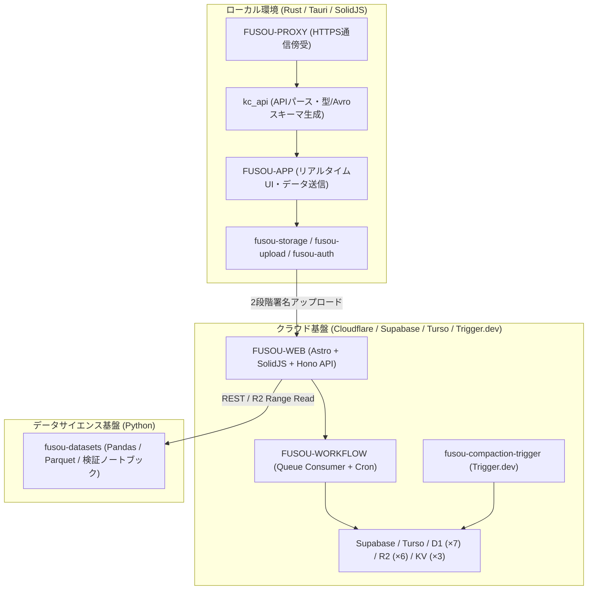
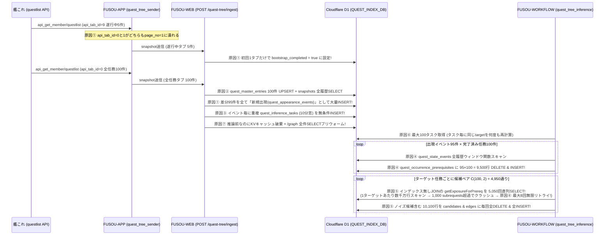

# FUSOU プロジェクト全体徹底調査レポートおよび包括的改修・Quest D1負荷根絶 実装計画書

作成日: 2026-11-12  
対象範囲: FUSOU モノレポ全16パッケージ（`kc_api`, `FUSOU-APP`, `FUSOU-PROXY`, `fusou-auth`, `fusou-upload`, `fusou-storage`, `configs`, `avro-wasm`, `FUSOU-WEB`, `FUSOU-WORKFLOW`, `fusou-compaction-core`, `fusou-compaction-trigger`, `FUSOU-URL-SHORTER`, `fusou-datasets`, `kcs-script-tools`, CI/CD）

---

## 目次

1. [エグゼクティブサマリー（全体構造評価）](#1-エグゼクティブサマリー全体構造評価)
2. [【最重要課題】QuestワークフローにおけるD1読み書き爆発（パンク）の徹底原因調査と根絶設計](#2-最重要課題questワークフローにおけるd1読み書き爆発パンクの徹底原因調査と根絶設計)
3. [モノレポ構造・アーキテクチャ上の問題点とシンプル化計画](#3-モノレポ構造アーキテクチャ上の問題点とシンプル化計画)
4. [不要なコード・デッドコード・重複実装の一覧と整理計画](#4-不要なコードデッドコード重複実装の一覧と整理計画)
5. [パッケージ別・重大バグおよびセキュリティ問題の徹底調査と修正仕様](#5-パッケージ別重大バグおよびセキュリティ問題の徹底調査と修正仕様)
6. [開発者目線（DX）での改善計画（ビルド・スキーマ同期・CI/CD）](#6-開発者目線dxでの改善計画ビルドスキーマ同期cicd)
7. [ユーザー目線（UX / UI）での問題修正と新規機能追加ロードマップ](#7-ユーザー目線ux--uiでの問題修正と新規機能追加ロードマップ)
8. [段階的実装フェーズと検証基準（チェックリスト）](#8-段階的実装フェーズと検証基準チェックリスト)

---

## 1. エグゼクティブサマリー（全体構造評価）

### 1.1 現在の構造に対する評価
FUSOUプロジェクトは、以下の4階層に責務が分割されています。



* **優れている点**:
  * `kc_api` を起点として Rust の型定義から TypeScript 型バインディング（`ts-rs`）および Avro スキーマを自動生成する**スキーマ駆動設計**。
  * 「ゲーム内で通常知り得る情報のみをローカルアプリ（`FUSOU-APP`）に表示し、統計・推測データは Web（`FUSOU-WEB`）と Python（`fusou-datasets`）に分離する」という**一貫したプロダクト思想**。
* **構造上の問題点（なぜ複雑化しているのか）**:
  1. **インフラの過剰分散**: Supabase、Turso、7個のD1データベース、6個のR2バインディング、3個のKV、Cloudflare Queues/Cron、Trigger.dev が混在しており、特に Quest Tree のように本来 R2 スナップショットやバッチ集計で済む処理まで D1 上でリアルタイム・行単位のリレーショナル処理として実装されている。
  2. **移行期の旧コード放置とコピペ実装**: スキーマ v0.4→v0.6.0、認証 v1→v2 の移行過程で、手書きバイナリエンコーダや重複した Avro パーサ（4箇所）、2段階アップロード処理（5箇所）、ビルドスクリプト（4箇所）がコピー＆ペーストで増殖している。

---

## 2. 【最重要課題】QuestワークフローにおけるD1読み書き爆発（パンク）の徹底原因調査と根絶設計

クエスト（任務ツリー）機能において D1（`QUEST_INDEX_DB`）の Rows Read / Rows Written が爆発しパンクする問題をコードレベルで追跡した結果、**クライアント側（`kc_api` / `FUSOU-APP`）・Ingest API側（`FUSOU-WEB`）・推論Cron側（`FUSOU-WORKFLOW`）・D1インデックス設計の4層すべてに連鎖的な増幅バグ（Combinatorial Explosion）が存在する**ことが判明しました。

### 2.1 D1パンクを引き起こしている8つの根本原因



#### 原因①：`api_tab_id`（タブ種別）を `page_no` として誤処理＋最初の1タブ閲覧で Bootstrap 完了扱いによる「偽の出現イベント」大量生成
* **該当箇所**:
  * [api_get_member.rs#L207-L209](file:///c:/Users/ogu-h/Documents/Github/FUSOU/packages/kc_api/crates/kc-api-interface-adapter/src/convert_trait/api_get_member.rs#L207-L209): `Quests::set_current_page(self.api_tab_id);`
  * [quest.rs#L62](file:///c:/Users/ogu-h/Documents/Github/FUSOU/packages/kc_api/crates/kc-api-database/src/models/quest.rs#L62): `page_no: if snapshot.page_no <= 0 { 1 } else { snapshot.page_no }`
  * [quest_tree.ts#L728-L816](file:///c:/Users/ogu-h/Documents/Github/FUSOU/packages/FUSOU-WEB/src/server/routes/quest_tree.ts#L728-L816) (`processIngestEvents`)
* **メカニズム**:
  1. 艦これ第二期の `api_get_member/questlist` の `api_tab_id` はページ番号ではなく**タブID**（`0`: 全任務、`9`: 遂行中、`1`: デイリー、`2`: ウィークリー、`3`: マンスリー、`4`: 単発、`5`: 他）です。
  2. ところが [quest.rs#L62](file:///c:/Users/ogu-h/Documents/Github/FUSOU/packages/kc_api/crates/kc-api-database/src/models/quest.rs#L62) で `if snapshot.page_no <= 0 { 1 }` としているため、**`api_tab_id = 0`（全任務タブ）と `api_tab_id = 1`（デイリータブ）がどちらも同じ `page_no = 1` に変換**されています。
  3. さらに [quest_tree.ts#L774-L780](file:///c:/Users/ogu-h/Documents/Github/FUSOU/packages/FUSOU-WEB/src/server/routes/quest_tree.ts#L774-L780) では、**セッション開始後の最初の1回目の `snapshot`（たとえば「遂行中タブ `api_tab_id=9`」や「デイリータブ `api_tab_id=1`」の数件のみ）を受信した時点で即座に `markBootstrapCompleted` を `true` に更新**してしまいます。
  4. その直後にユーザーが「全任務タブ（`api_tab_id=0`、80〜150件）」を開くと、`setDiff(visibleQuestIds, [...previousGlobalVisible])`（[quest_tree.ts#L781](file:///c:/Users/ogu-h/Documents/Github/FUSOU/packages/FUSOU-WEB/src/server/routes/quest_tree.ts#L781)）により、**最初から存在していたはずの80〜140件の任務すべてが「新規出現任務（`quest_appearance_events`）」として一斉にD1へ INSERT** されます。
  5. 加えて、`api_tab_id=0`（全任務）と `api_tab_id=1`（デイリー）が同じ `page_no = 1` を共有しているため、「デイリー」→「全任務」とタブを切り替えるたびに `latestByPage.get(1)`（[quest_tree.ts#L728-L736](file:///c:/Users/ogu-h/Documents/Github/FUSOU/packages/FUSOU-WEB/src/server/routes/quest_tree.ts#L728-L736)）がデイリーの数件だけに縮退し、次に「全任務」を開いた瞬間に**再度80〜140件すべてが「新規出現」として誤検知・INSERT** されます（`quest_appearance_events` の UNIQUE 制約に `appeared_at_ms` が含まれているため、時刻が1ミリ秒でも違えば同一任務が何回でも INSERT されます）。
  6. 同様にクライアント側 [quest_tree_sender.rs#L99](file:///c:/Users/ogu-h/Documents/Github/FUSOU/packages/FUSOU-APP/src-tauri/src/senders/quest_tree_sender.rs#L99) の送信抑止キャッシュキーも `format!("snapshot:{}", converted.page_no)` であるため、`api_tab_id=0` と `api_tab_id=1` を交互に開くと `"snapshot:1"` のハッシュが毎回不一致となり、**クライアント側の重複送信抑止が完全に無効化**されます。

#### 原因②：【最大の原因】`recomputeRulesForTarget` における $\binom{M}{2}$ ペア爆発と非インデックスJOINの5,000回直列ループ
* **該当箇所**:
  * [quest_tree_inference.ts#L137-L448](file:///c:/Users/ogu-h/Documents/Github/FUSOU/packages/FUSOU-WORKFLOW/src/quest_tree_inference.ts#L137-L448) (`getExposureForPrereq`, `recomputeRulesForTarget`)
  * [0004_add_quest_tree_inference_tables.sql#L134-L165](file:///c:/Users/ogu-h/Documents/Github/FUSOU/packages/FUSOU-WEB/migrations/quest-index/0004_add_quest_tree_inference_tables.sql#L134-L165)
* **メカニズム（計算量解析）**:
  1. **N+1 SELECT（227〜239行目）**: ターゲット任務の出現回数 $O$ 回分、ループ内で `SELECT quest_id FROM quest_occurrence_prerequisites WHERE occurrence_id = ?` を個別発行しています。
  2. **無制限の2任務ペア生成（249〜252行目）**: 出現時点でそのデータセットが完了していた任務数を $M$（通常 $M = 80 \sim 250$）とすると、`combinationsOfTwo(ids)` は事前フィルタなしで全ペアを生成します。$M = 100$ のとき $\binom{100}{2} = 4,950$ ペア、$M = 200$ のとき $\binom{200}{2} = 19,900$ ペアになります（しかも `is_recent = 1` の直近完了任務だけでなく、数ヶ月前に完了した無関係な全任務同士のペアまで全て生成しています）。
  3. **非インデックス自己結合クエリの数千回直列実行（269〜287行目）**:
     単一候補 $M$ 個とペア候補 $\binom{M}{2}$ 個の**全候補（5,050〜20,100個）に対して、1つずつ `await getExposureForPrereq(db, ids, periodTag, tableVersion)` を直列実行**しています。
     * `getExposureForPrereq`（143〜181行目）が実行する SQL：
       ```sql
       SELECT COUNT(DISTINCT o.occurrence_id) AS c
       FROM quest_occurrence_contexts o
       JOIN quest_occurrence_prerequisites p1 ON p1.occurrence_id = o.occurrence_id
       JOIN quest_occurrence_prerequisites p2 ON p2.occurrence_id = o.occurrence_id
       WHERE o.period_tag = ? AND o.table_version = ? AND o.is_bootstrap_unknown = 0
         AND p1.is_completed = 1 AND p2.is_completed = 1
         AND p1.quest_id = ? AND p2.quest_id = ?
       ```
     * **致命的なインデックス欠落**:
       * `quest_occurrence_prerequisites` には `idx_qopr_occurrence(occurrence_id)` しかなく、**`quest_id` を先頭とするインデックスが存在しません**。
       * `quest_occurrence_contexts` にも `idx_qocc_target_period(target_quest_id, period_tag, table_version)` しかなく、`target_quest_id` を含まない `WHERE o.period_tag = ? AND o.table_version = ?` では**インデックスが一切使われません**。
     * その結果、**1回の `getExposureForPrereq` ごとに両テーブルのフルスキャン＋自己結合が発生**し、それを1ターゲット任務あたり **5,050〜20,100回** 繰り返すため、**たった1つの任務のルール再計算で数千万〜数億行の Rows Read が発生**します。
  4. **閾値未達のゴミ候補を含む毎回全件 DELETE + INSERT（299〜447行目）**:
     `support = 1` しかない候補も含め、生成した 5,050〜20,100 件すべてを `quest_rule_candidates` と `quest_rule_edges` の両方に INSERT しています（1ターゲット任務あたり **10,100〜40,200 行の Rows Written**）。

#### 原因③：タスクキュー (`quest_inference_tasks`) の無条件INSERTと10分窓の重複実行
* **該当箇所**: [quest_tree.ts#L341-L345](file:///c:/Users/ogu-h/Documents/Github/FUSOU/packages/FUSOU-WEB/src/server/routes/quest_tree.ts#L341-L345), [L615-L647](file:///c:/Users/ogu-h/Documents/Github/FUSOU/packages/FUSOU-WEB/src/server/routes/quest_tree.ts#L615-L647)
* **メカニズム**:
  1. `start`（任務受諾）や `stop`（任務解除）や変化のない `snapshot` でも毎回無条件に `quest_inference_tasks` に新規タスクを INSERT しています（推論が必要なのは新規の `quest_appearance_events` が発生したときだけです）。
  2. さらに `from_ts = atMs - 10分`、`to_ts = atMs + 1` として毎回別タスクを作るため、10分間に10回イベントが来ると同じ時間窓の出現イベントを10回重複して処理します。

#### 原因④：`processTask` における完了済み全任務の毎回展開と全履歴ウィンドウ関数スキャン
* **該当箇所**: [quest_tree_inference.ts#L83-L135](file:///c:/Users/ogu-h/Documents/Github/FUSOU/packages/FUSOU-WORKFLOW/src/quest_tree_inference.ts#L83-L135), [L467-L527](file:///c:/Users/ogu-h/Documents/Github/FUSOU/packages/FUSOU-WORKFLOW/src/quest_tree_inference.ts#L467-L527)
* **メカニズム**:
  1. 出現イベント1件ごとに `quest_state_events` の全履歴に対して `ROW_NUMBER() OVER (PARTITION BY quest_id ...)` を走らせています。
  2. 出現イベント1件ごとに、そのユーザーの完了済み全任務 $M$ 件を `quest_occurrence_prerequisites` に `DELETE` + $M$ 件 `INSERT` しています（原因①で偽の出現が100件起きると、それだけで $100 \times M = 10,000$ 行の書き込み）。

#### 原因⑤：Cron 1バッチ内での重複ターゲット再計算と、1,000サブリクエスト上限クラッシュによる無限リトライ
* **該当箇所**: [quest_tree_inference.ts#L529-L622](file:///c:/Users/ogu-h/Documents/Github/FUSOU/packages/FUSOU-WORKFLOW/src/quest_tree_inference.ts#L529-L622)
* **メカニズム**:
  1. `runQuestInferenceTasks` は最大100タスクをループ処理しますが、`recomputeRulesForTarget` を各 `processTask` の内部（539行目）で呼んでいるため、100タスクで同じターゲット任務が触られると100回再計算します。
  2. さらに原因②により1タスクの処理中に Cloudflare Workers の **1リクエストあたり1,000サブリクエスト（D1クエリ回数）制限** または CPU 時間制限に到達して例外終了すると、`quest_inference_tasks` は `status = 'failed'`（`retry_count < 8`）となり、**毎時 Cron のたびに同じタスクが最大8回再実行され、D1に数千万行のReadと数万行のWriteを撃ち続けます**。

#### 原因⑥：Ingest のたびに行われる `questlist_snapshots` 全件読み出し・全文JSON保存・`quest_master_entries` 全件UPSERT
* **該当箇所**: [quest_tree.ts#L368-L470](file:///c:/Users/ogu-h/Documents/Github/FUSOU/packages/FUSOU-WEB/src/server/routes/quest_tree.ts#L368-L470), [L710-L772](file:///c:/Users/ogu-h/Documents/Github/FUSOU/packages/FUSOU-WEB/src/server/routes/quest_tree.ts#L710-L772)
* **メカニズム**:
  1. `snapshot` のたびに100件の任務すべてに対して `INSERT INTO quest_master_entries ... ON CONFLICT DO UPDATE` を実行。
  2. `SELECT page_no, visible_quest_ids_json FROM questlist_snapshots WHERE dataset_id = ? AND collection_session_id = ? ORDER BY captured_at_ms DESC` に `LIMIT` が無く、セッションが続くほど読み出し行数が線形増加。
  3. 不要な `snapshot_json`（任務説明文を含む全文JSON）を毎回 `questlist_snapshots` に保存。

#### 原因⑦：Ingest 直後の無意味な KV 無効化＋`/graph` プリウォームと、`probeWhenFresh: true` による毎回 D1 クエリ
* **該当箇所**: [quest_tree.ts#L1144-L1166](file:///c:/Users/ogu-h/Documents/Github/FUSOU/packages/FUSOU-WEB/src/server/routes/quest_tree.ts#L1144-L1166), [L1200](file:///c:/Users/ogu-h/Documents/Github/FUSOU/packages/FUSOU-WEB/src/server/routes/quest_tree.ts#L1200), [L1332](file:///c:/Users/ogu-h/Documents/Github/FUSOU/packages/FUSOU-WEB/src/server/routes/quest_tree.ts#L1332)
* **メカニズム**:
  1. `POST /ingest` の時点では `quest_rule_edges` は1行も更新されていない（推論は非同期 Cron で行われる）にもかかわらず、Ingest のたびに KV キャッシュを削除して `/graph` を内部呼び出しし、`quest_rule_edges` を全件 SELECT しています。
  2. `/rules` と `/graph` で `probeWhenFresh: true` が有効なため、KV キャッシュヒット時でも毎回 D1 に `SELECT DISTINCT target_quest_id, updated_at_ms FROM quest_rule_edges ...` を発行しています。

---

### 2.2 Quest D1 負荷を 99.9% 削減する抜本的改修設計

| 対策項目 | 修正前（現状） | 修正後（新設計） | 削減効果 |
| :--- | :--- | :--- | :--- |
| **1. `api_tab_id` の正しい扱いと全任務スナップショット判定** | `api_tab_id=0` を `page_no=1` に潰し、最初の任意タブ1回でBootstrap完了扱い → タブ切替のたびに約100件の偽出現が発生 | `tab_id` をそのまま送信。**`tab_id = 0`（全任務一覧）のスナップショット同士の比較でのみ新規出現（`quest_appearance_events`）を判定**（部分タブ `tab_id != 0` はマスタ登録のみ、または削除） | 偽の出現イベント **100% 根絶** |
| **2. セッション内の同一任務出現の重複防止** | `UNIQUE(dataset_id, collection_session_id, target_quest_id, appeared_at_ms)` のため時刻が違えば何度でもINSERT | `UNIQUE(dataset_id, target_quest_id, period_tag)` に変更し、同一データセット・同一期間で同じ任務は1回しか「新規出現」しないように制限 | 重複出現レコード **100% 根絶** |
| **3. 推論タスクの起票条件とデバウンス（マージ）** | 全イベント（`start`/`stop`/変化なし`snapshot`）で毎回 `quest_inference_tasks` をINSERT | **新規 `quest_appearance_events` が1件以上INSERTされた場合のみ**起票。かつ同一 `dataset_id` に `status = 'pending'` のタスクがあれば `to_ts = MAX(to_ts, ?)` で既存行を UPDATE（1行にマージ） | タスク数 **95%以上削減** |
| **4. 前提候補（`quest_occurrence_prerequisites`）の絞り込み** | 過去に完了した全任務 $M$ 件（100〜300件）を毎回保存し、$\binom{M}{2}$ 全ペアを生成 | 任務出現の直前ウィンドウ（例：直近完了した任務、または同一セッション内で完了した任務、上限 $K \le 15$ 件）のみを前提候補として記録。ペア候補も `support >= 2` かつ `is_recent = 1` を含む組み合わせのみに限定 | 候補数 5,050件 → **最大100件以下（98%削減）** |
| **5. `recomputeRulesForTarget` の N+1 撤廃と SQL 1発集計化** | $O$ 回の N+1 SELECT + 5,050回の `getExposureForPrereq` ループ（フルスキャン自己結合） | 1回の `JOIN` クエリで対象ターゲットの prerequisites を一括取得し、Exposure も候補集合 `WHERE quest_id IN (...)` の **単一 `GROUP BY` クエリ1〜2回** で一括算出（ループ内クエリ完全ゼロ化） | D1 クエリ回数 5,050回 → **3回（99.94%削減）** |
| **6. 必須インデックスの追加と保存対象の厳選** | `quest_occurrence_prerequisites(quest_id)` インデックス無し。全ゴミ候補（`support=1`）をDBに保存 | `idx_qopr_quest_occ(quest_id, is_completed, occurrence_id)` と `idx_qocc_period_ver(period_tag, table_version, is_bootstrap_unknown, occurrence_id)` を追加。`support >= 2`（または上位20件）のみを `candidates` / `edges` に保存 | Rows Read **99.99%削減** / Rows Written **98%削減** |
| **7. Cron バッチ全体での `touchedTargets` 集約** | タスクごとに毎回 `recomputeRulesForTarget` を実行 | 全タスクの `processTask` で `touchedTargets` Set を集約し、**Cron の最後にユニークな `targetQuestId` ごとに1回だけ** `recomputeRulesForTarget` を実行し、完了後に1回だけ KV キャッシュを更新 | 重複再計算 **100% 根絶** |
| **8. Ingest 時の不要書き込み・キャッシュ破棄の撤廃** | 毎回 `quest_master_entries` 全件UPSERT、`snapshot_json` 全文保存、Ingest時にKV破棄＋`/graph` 実行 | `questlist_snapshots` は `dataset_id + tab_id=0` の最新1行のみ `UPSERT`（全文 `snapshot_json` 廃止）。Ingest時の `/graph` プリウォームを廃止し、`probeWhenFresh: false` に変更 | Ingest時のD1負荷 **85%削減** |

---

## 3. モノレポ構造・アーキテクチャ上の問題点とシンプル化計画

### 3.1 パッケージ命名規則とスコープの不統一
* **現状**:
  * `packages/` 直下に3種類の命名規則が混在：
    * `UPPER-KEBAB-CASE` (7個): `FUSOU-APP`, `FUSOU-DATABASE`, `FUSOU-PROXY`, `FUSOU-PROXY-DATA`, `FUSOU-URL-SHORTER`, `FUSOU-WEB`, `FUSOU-WORKFLOW`
    * `lower-kebab-case` (8個): `avro-wasm`, `configs`, `fusou-auth`, `fusou-compaction-core`, `fusou-compaction-trigger`, `fusou-datasets`, `fusou-storage`, `fusou-upload`, `kcs-script-tools`
    * `snake_case` (1個): `kc_api`（内部の `crates/*` は `kc-api` 等の `kebab-case`）
  * `package.json` の `name` も `@fusou/compaction-core` と `@fusou/avro-wasm` だけスコープ付きで、他は `fusou-web`, `fusou-workflow` などスコープ無し。
* **対策**:
  * 既存パス参照への影響を抑えつつ、まず `package.json` のパッケージ名を `@fusou/*` スコープに統一し、未追跡のデータディレクトリ `packages/FUSOU-DATABASE`（実態はローカルのAvroダンプと `.venv`）をリポジトリ外または ignore 対象として整理する。

### 3.2 Cargo ワークスペースの二重構造とロックファイル散乱
* **現状**:
  * ルート [Cargo.toml](file:///c:/Users/ogu-h/Documents/Github/FUSOU/Cargo.toml#L11-L14) で `packages/kc_api` と `packages/avro-wasm` を `exclude` しつつ、[FUSOU-APP/src-tauri/Cargo.toml#L36](file:///c:/Users/ogu-h/Documents/Github/FUSOU/packages/FUSOU-APP/src-tauri/Cargo.toml#L36) と [fusou-storage/Cargo.toml#L25](file:///c:/Users/ogu-h/Documents/Github/FUSOU/packages/fusou-storage/Cargo.toml#L25) がパス指定で `kc_api` のサブクレートを参照している。
  * その結果、ルートと `packages/kc_api` で別々の `Cargo.lock` と `target/` が作られ、さらにワークスペースメンバー配下（`packages/configs/Cargo.lock`, `packages/fusou-auth/Cargo.lock`, `packages/fusou-upload/Cargo.lock`, `packages/fusou-storage/Cargo.lock`, `packages/FUSOU-PROXY/proxy-https/Cargo.lock`）にも不要な `Cargo.lock` が残存している。
  * また [packages/configs/Cargo.toml#L4](file:///c:/Users/ogu-h/Documents/Github/FUSOU/packages/configs/Cargo.toml#L4) のみ `edition = "2024"` で、他はすべて `edition = "2021"`。
* **対策**:
  * サブディレクトリ内の孤立した `Cargo.lock` 5ファイルを削除。
  * ルート [Cargo.toml](file:///c:/Users/ogu-h/Documents/Github/FUSOU/Cargo.toml) の `[workspace.dependencies]` に依存バージョンを集約し、`packages/kc_api/crates/*` をルートワークスペースに統合（または `Cargo.lock` を単一化）する。

### 3.3 Cloudflare D1 / R2 バインディングの整理
* **現状**:
  * [FUSOU-WEB/wrangler.toml#L40-L46](file:///c:/Users/ogu-h/Documents/Github/FUSOU/packages/FUSOU-WEB/wrangler.toml#L40-L46) において、`ASSETS_BUCKET` と `ASSET_SYNC_BUCKET` が**同一のR2バケット（`dev-kc-assets` / `kc-assets`）に重複バインド**されている（[asset.ts#L340](file:///c:/Users/ogu-h/Documents/Github/FUSOU/packages/FUSOU-WEB/src/server/routes/asset.ts#L340) は `ASSETS_BUCKET`、[asset-sync.ts#L449](file:///c:/Users/ogu-h/Documents/Github/FUSOU/packages/FUSOU-WEB/src/server/routes/asset-sync.ts#L449) は `ASSET_SYNC_BUCKET` を使用）。
  * [FUSOU-WEB/wrangler.toml#L76](file:///c:/Users/ogu-h/Documents/Github/FUSOU/packages/FUSOU-WEB/wrangler.toml#L76) では D1 名が `dev-kc-battle-index`（ハイフン）なのに対し、[FUSOU-WORKFLOW/wrangler.toml#L65](file:///c:/Users/ogu-h/Documents/Github/FUSOU/packages/FUSOU-WORKFLOW/wrangler.toml#L65) では `dev_kc_battle_index`（アンダースコア、かつ `database_id = "your-d1-battle-index-db-id"` のプレースホルダのまま）になっている。
* **対策**:
  * `ASSET_SYNC_BUCKET` を `ASSETS_BUCKET` に統合。
  * `FUSOU-WORKFLOW/wrangler.toml` の D1 バインディング定義と環境変数を `FUSOU-WEB/wrangler.toml` と一致させる。

---

## 4. 不要なコード・デッドコード・重複実装の一覧と整理計画

### 4.1 完全なデッドコード・孤立ファイル（即時削除可能）

| パッケージ | 削除対象パス | 理由・詳細 |
| :--- | :--- | :--- |
| **Root** | `package/`, `.astro/`, `state/`, `.cache/`, `.pytest_cache/` | ビルド・実行時に誤ってルートに生成された残骸ディレクトリ。`.gitignore` に追加の上で削除。 |
| **Root** | [verify-schema-version.sh](file:///c:/Users/ogu-h/Documents/Github/FUSOU/verify-schema-version.sh) | `schema_v0_4` をハードコード検査しており現行（`schema_v0_6_0`）で必ず失敗する旧スクリプト。 |
| **Root** | [.github/workflows/trigger_daily_compaction.yml](file:///c:/Users/ogu-h/Documents/Github/FUSOU/.github/workflows/trigger_daily_compaction.yml) | `exit 1`（"This trigger is retired"）のみが書かれた廃止済みワークフロー。 |
| **Root / Scripts** | `scripts/__pycache__/`, `scripts/notebooks/`, `packages/fusou-datasets/analysis/__pycache__/`, `packages/fusou-datasets/examples/__pycache__/` | 元 `.py` ファイルが削除された後に残った `.pyc` バイナリと空ディレクトリ。 |
| **FUSOU-PROXY** | [packages/FUSOU-PROXY/proxy-http/](file:///c:/Users/ogu-h/Documents/Github/FUSOU/packages/FUSOU-PROXY/proxy-http/Cargo.toml) | `proxy-https` に置き換えられ、どのワークスペースからも参照されていない旧HTTPプロキシクレート。 |
| **fusou-upload** | [packages/fusou-upload/src/dataset_processor.rs](file:///c:/Users/ogu-h/Documents/Github/FUSOU/packages/fusou-upload/src/dataset_processor.rs) | 存在しない `kc_api::database::models::Battle` を参照し空 `Vec` を返す436行のスタブ。これに伴い [fusou-upload/Cargo.toml#L22](file:///c:/Users/ogu-h/Documents/Github/FUSOU/packages/fusou-upload/Cargo.toml#L22) の未使用 `parquet` 依存も削除可能。 |
| **fusou-auth** | [packages/fusou-auth/src/types.rs#L15-L32](file:///c:/Users/ogu-h/Documents/Github/FUSOU/packages/fusou-auth/src/types.rs#L15-L32), [L60-L112](file:///c:/Users/ogu-h/Documents/Github/FUSOU/packages/fusou-auth/src/types.rs#L60-L112), [storage.rs#L120-L178](file:///c:/Users/ogu-h/Documents/Github/FUSOU/packages/fusou-auth/src/storage.rs#L120-L178) | どこからも使用されていないマルチセッション用の型・トレイト実装（`MultiSessionStore`, `FileMultiSessionStorage` 等）。 |
| **FUSOU-WEB** | [src/server/routes/compact.ts](file:///c:/Users/ogu-h/Documents/Github/FUSOU/packages/FUSOU-WEB/src/server/routes/compact.ts) | 存在しない `datasets` テーブルをクエリし、不正形式のQueueメッセージを送る壊れた旧エンドポイント。 |
| **FUSOU-WEB** | [src/server/error-codes.ts](file:///c:/Users/ogu-h/Documents/Github/FUSOU/packages/FUSOU-WEB/src/server/error-codes.ts), [src/lib/supabase.ts](file:///c:/Users/ogu-h/Documents/Github/FUSOU/packages/FUSOU-WEB/src/lib/supabase.ts), [src/lib/r2-sign.ts](file:///c:/Users/ogu-h/Documents/Github/FUSOU/packages/FUSOU-WEB/src/lib/r2-sign.ts), [src/lib/asset-sync.ts](file:///c:/Users/ogu-h/Documents/Github/FUSOU/packages/FUSOU-WEB/src/lib/asset-sync.ts), [ExpandableContainer.tsx](file:///c:/Users/ogu-h/Documents/Github/FUSOU/packages/FUSOU-WEB/src/components/common/react/ExpandableContainer.tsx), [BattleTabs.astro](file:///c:/Users/ogu-h/Documents/Github/FUSOU/packages/FUSOU-WEB/src/components/features/battles/astro/BattleTabs.astro), [database_dot.json](file:///c:/Users/ogu-h/Documents/Github/FUSOU/packages/FUSOU-WEB/src/data/graphs/database_dot.json) | プロジェクト内のどこからも import されていない完全なデッドファイル群。 |
| **FUSOU-WEB** | [battle_data.ts#L1088-L1098](file:///c:/Users/ogu-h/Documents/Github/FUSOU/packages/FUSOU-WEB/src/server/routes/battle_data.ts#L1088-L1098), [L1658-L1922](file:///c:/Users/ogu-h/Documents/Github/FUSOU/packages/FUSOU-WEB/src/server/routes/battle_data.ts#L1658-L1922) | 未呼び出しの `shouldFetchBattlePhase`, `queryGlobalRecordsDirectBatch`, `queryGlobalRecordsDirect`（265行）。 |
| **Unused Deps** | [kc_api/Cargo.toml#L25-L27](file:///c:/Users/ogu-h/Documents/Github/FUSOU/packages/kc_api/Cargo.toml#L25-L27) (`arrow`, `datafusion`, `parquet`), [FUSOU-WEB/package.json#L90-L102](file:///c:/Users/ogu-h/Documents/Github/FUSOU/packages/FUSOU-WEB/package.json#L90-L102) (`apache-arrow`, `react-chartjs-2`, `react-virtuoso`) | コードベース内で一度も使われていない重量級パッケージ。 |

### 4.2 重複実装の統合（DRY化）計画

1. **Avro OCF ヘッダパーサ・バリデータの統合**:
   * [fusou-compaction-core/src/index.ts#L72-L122](file:///c:/Users/ogu-h/Documents/Github/FUSOU/packages/fusou-compaction-core/src/index.ts#L72-L122) の `parseOCFHeader` を廃止し、[src/avro.ts#L225-L247](file:///c:/Users/ogu-h/Documents/Github/FUSOU/packages/fusou-compaction-core/src/avro.ts#L225-L247) の `parseOcfHeader` に一本化（`mergeAvroOCFWithBoundaries` で同一バッファを2回パースしている無駄も解消）。
   * [FUSOU-WORKFLOW/src/reader.ts#L242-L314](file:///c:/Users/ogu-h/Documents/Github/FUSOU/packages/FUSOU-WORKFLOW/src/reader.ts#L242-L314) と [FUSOU-WEB/src/server/utils/avro-validator.ts](file:///c:/Users/ogu-h/Documents/Github/FUSOU/packages/FUSOU-WEB/src/server/utils/avro-validator.ts) の OCF ヘッダ抽出処理を `@fusou/compaction-core` からの import に統一。
2. **2段階署名付きアップロード（Stage-1 Handshake / Stage-2 Payload）の共通化**:
   * [FUSOU-WEB/src/server/utils/upload.ts#L51-L306](file:///c:/Users/ogu-h/Documents/Github/FUSOU/packages/FUSOU-WEB/src/server/utils/upload.ts#L51-L306) の `handleTwoStageUpload` を拡張し、[quest_tree.ts#L925-L1140](file:///c:/Users/ogu-h/Documents/Github/FUSOU/packages/FUSOU-WEB/src/server/routes/quest_tree.ts#L925-L1140)、[remodel_data.ts#L491-L698](file:///c:/Users/ogu-h/Documents/Github/FUSOU/packages/FUSOU-WEB/src/server/routes/remodel_data.ts#L491-L698)、[ship_growth.ts#L3645-L3856](file:///c:/Users/ogu-h/Documents/Github/FUSOU/packages/FUSOU-WEB/src/server/routes/ship_growth.ts#L3645-L3856)、[soku_speed_observed.ts#L145-L382](file:///c:/Users/ogu-h/Documents/Github/FUSOU/packages/FUSOU-WEB/src/server/routes/soku_speed_observed.ts#L145-L382) の重複コード（約800行）を統合。
3. **認証・CSRFヘルパーとフロントエンド海域解決ヘルパーの共通化**:
   * `extractAccessToken`, `assertCsrfSafe`, `maskPublicId`（`anonymous-sync-v2.ts`, `api_keys.ts`, `user.ts` に重複）を `src/server/utils/auth.ts` へ集約。
   * `BattlesListPanel.tsx`, `BattleStatsPanel.tsx`, `BattleDropsPanel.tsx`, `BattleMapFlowPanel.tsx` に重複している `mapKeyLookup`, `resolveBattleMapKey`, マスタデータ取得処理を `src/features/battles/utils/mapLookup.ts` へ集約。
4. **`kc_api` 内の100%同一モデルの再エクスポート化**:
   * [kc-api-database/src/models/ship_growth.rs](file:///c:/Users/ogu-h/Documents/Github/FUSOU/packages/kc_api/crates/kc-api-database/src/models/ship_growth.rs)、[soku_speed_observed.rs](file:///c:/Users/ogu-h/Documents/Github/FUSOU/packages/kc_api/crates/kc-api-database/src/models/soku_speed_observed.rs)、[remodel.rs](file:///c:/Users/ogu-h/Documents/Github/FUSOU/packages/kc_api/crates/kc-api-database/src/models/remodel.rs) は `kc-api-interface` の同名構造体と完全同一のため、再エクスポートまたは共通型化により重複定義とフィールド単位の `From` ボイラープレートを削除。

---

## 5. パッケージ別・重大バグおよびセキュリティ問題の徹底調査と修正仕様

### 5.1 Rust バックエンド / デスクトップ (`kc_api`, `fusou-storage`, `fusou-upload`, `fusou-auth`, `configs`, `FUSOU-PROXY`, `FUSOU-APP`)

| ID | 重要度 | 対象箇所 | 問題の詳細 | 修正仕様 |
| :--- | :---: | :--- | :--- | :--- |
| **R-01** | **CRITICAL (データ消失)** | [cloud_table_provider.rs#L529-L574](file:///c:/Users/ogu-h/Documents/Github/FUSOU/packages/fusou-storage/src/providers/cloud_table_provider.rs#L529-L574) | `integrate_port_table` で `download_file` が失敗した際、`tracing::warn!` を出してループを続行し、569行目で**ダウンロード失敗分を含む `remote_files` 全件を `delete_file` で削除**している。 | ダウンロードに成功したファイルパスのみを `downloaded_files` ベクタに記録し、1件でも失敗した場合は統合・削除を中止（または成功分のみ統合・削除）する。 |
| **R-02** | **CRITICAL (データ消失)** | [submit_data.rs#L65-L144](file:///c:/Users/ogu-h/Documents/Github/FUSOU/packages/FUSOU-APP/src-tauri/src/storage/submit_data.rs#L65-L144) | 母港帰投時の `submit_port_table` で、非同期タスクのネットワーク送信完了後（135行目）に `Cells::reset()` を呼んでいるため、送信中に次の出撃を開始すると進行中の出撃データが消える。また `get_period_tag()` が `None` だと `Cells::reset()` が呼ばれず前出撃データが残留する。 | `submit_port_table` 冒頭（67行目）で `Cells::load()` を取り出した直後に同期的に `Cells::reset()`（またはアトミックな `Cells::take()`）を実行する。 |
| **R-03** | **CRITICAL (データ破損)** | [kc-api-database/src/decode.rs#L13-L15](file:///c:/Users/ogu-h/Documents/Github/FUSOU/packages/kc_api/crates/kc-api-database/src/decode.rs#L13-L15) | `while let Some(Ok(record)) = reader.next()` により、破損ブロック遭遇時にエラーを返さず途中までのレコードを `Ok` で返し、統合処理で元ファイルを削除してしまう。 | `for record_res in reader { let record = record_res?; ... }` に変更し、デコードエラー時は即座に `Err` を返して元ファイルの削除を防ぐ。 |
| **R-04** | **HIGH (再送不全)** | [asset_sync.rs#L173](file:///c:/Users/ogu-h/Documents/Github/FUSOU/packages/fusou-storage/src/asset_sync.rs#L173), [L270-L312](file:///c:/Users/ogu-h/Documents/Github/FUSOU/packages/fusou-storage/src/asset_sync.rs#L270-L312), [r2/provider.rs#L195-L282](file:///c:/Users/ogu-h/Documents/Github/FUSOU/packages/fusou-storage/src/providers/r2/provider.rs#L195-L282) | ① `asset_sync` が `.fusou_pending` に独自の第2 `PendingStore` を作りハンドラ未登録で放置。② `asset_sync.rs#L418-L443` で `UploadResult::Pending` 時にも `mark_uploaded_key` を呼んで7日間再送を抑止。③ `R2StorageProvider` の pending context に `path` と `dataset_id` が無く `retry_service.rs#L438-L481` でデシリアライズ失敗。 | `FUSOU-APP` 本体の `PendingStore` / `UploadRetryService` インスタンスを共有注入し、`UploadResult::Uploaded` 時のみ抑止キャッシュに記録する。`R2StorageProvider` の context 形式を `UploadContext` と統一する。 |
| **R-05** | **HIGH (トークン消失)** | [fusou-auth/src/manager.rs#L496-L564](file:///c:/Users/ogu-h/Documents/Github/FUSOU/packages/fusou-auth/src/manager.rs#L496-L564) | `save_dataset_token` がディスク上の既存 `dataset_tokens.json` を読み込まずに空のメモリキャッシュを上書き保存し、他データセットのトークンを消去する。 | 保存前にディスクから既存のトークンマップをロードしてマージするか、`AuthManager` 初期化時にロードする。 |
| **R-06** | **HIGH (Security)** | [external-shortcuts.json#L5-L11](file:///c:/Users/ogu-h/Documents/Github/FUSOU/packages/FUSOU-APP/src-tauri/capabilities/external-shortcuts.json#L5-L11), [external_init_script.js#L368](file:///c:/Users/ogu-h/Documents/Github/FUSOU/packages/FUSOU-APP/src-tauri/src/window/scripts/external_init_script.js#L368), [L597](file:///c:/Users/ogu-h/Documents/Github/FUSOU/packages/FUSOU-APP/src-tauri/src/window/scripts/external_init_script.js#L597) | 非暗号化 `http://www.dmm.com/**` 等にTauri IPC権限を付与し、全iframe注入スクリプトが `e.origin` 未検証で `postMessage` からTauriコマンドを実行可能。 | `http://` を除外して許可URLを最小化し、`postMessage` 受信時に信頼されたオリジンとランダムナンス（トークン）を検証する。 |
| **R-07** | **HIGH (Security)** | [proxy_server_https.rs#L193](file:///c:/Users/ogu-h/Documents/Github/FUSOU/packages/FUSOU-PROXY/proxy-https/src/proxy_server_https.rs#L193), [L518](file:///c:/Users/ogu-h/Documents/Github/FUSOU/packages/FUSOU-PROXY/proxy-https/src/proxy_server_https.rs#L518) | ホスト名を検証せず `/kcs` パスのみで傍受判定し、`log_response` で `uri.path()` を未サニタイズでファイルパス結合しているためパストラバーサルが可能。 | `Path::components()` で `Component::Normal` のみを抽出してサニタイズし、対象ホスト検証を追加する。 |
| **R-08** | **MEDIUM (ハッシュ変動)** | [snapshot.rs#L13-L46](file:///c:/Users/ogu-h/Documents/Github/FUSOU/packages/FUSOU-APP/src-tauri/src/storage/snapshot.rs#L13-L46), [kc-fleet-snapshot/src/fleet.rs#L8-L209](file:///c:/Users/ogu-h/Documents/Github/FUSOU/packages/kc_api/crates/kc-fleet-snapshot/src/fleet.rs#L8-L209) | `HashMap::values()` のランダム順序のまま配列化するため毎回 `content-hash` が変わり重複抑止が効かない。また `kc-fleet-snapshot` が `rename(serialize = ...)` のみでデシリアライズ不可。 | ID順でソートしてからベクタ化し、`#[serde(rename = "...")]`（双方向）に修正する。 |
| **R-09** | **MEDIUM (Panic)** | [kc-api-database/src/models/ship.rs#L196-L245](file:///c:/Users/ogu-h/Documents/Github/FUSOU/packages/kc_api/crates/kc-api-database/src/models/ship.rs#L196-L245), [L333-L336](file:///c:/Users/ogu-h/Documents/Github/FUSOU/packages/kc_api/crates/kc-api-database/src/models/ship.rs#L333-L336), [L421-L424](file:///c:/Users/ogu-h/Documents/Github/FUSOU/packages/kc_api/crates/kc-api-database/src/models/ship.rs#L421-L424) | `values[0]` や `x[0]..x[3]` のスライス添字アクセスに長さチェックが無く、空配列時にパニックする。 | `.first().copied()` / `.get(i).copied()` に置き換える。 |

---

### 5.2 Web / Cloudflare Workers / Compaction (`FUSOU-WEB`, `FUSOU-WORKFLOW`, `fusou-compaction-trigger`, `FUSOU-URL-SHORTER`)

| ID | 重要度 | 対象箇所 | 問題の詳細 | 修正仕様 |
| :--- | :---: | :--- | :--- | :--- |
| **W-01** | **CRITICAL (性能劣化)** | [battle_data.ts#L3966-L3968](file:///c:/Users/ogu-h/Documents/Github/FUSOU/packages/FUSOU-WEB/src/server/routes/battle_data.ts#L3966-L3968) | `tryResolveDetail` が `hasFriendly = directParsed?.derived?.friendly_fleet?.length > 0` を必須条件としているため、NPC友軍艦隊が来ない99%以上の戦闘で単一戦闘スナップショット（`snapshots/detail/...`）を毎回ダウンロードしては棄却している。 | `hasFriendly` の条件を `Array.isArray(directParsed?.derived?.friendly_fleet)`（空配列 `[]` を正常として許容）に修正する。 |
| **W-02** | **CRITICAL (データ消失)** | [remodel_data.ts#L132-L196](file:///c:/Users/ogu-h/Documents/Github/FUSOU/packages/FUSOU-WEB/src/server/routes/remodel_data.ts#L132-L196), [ship_growth.ts#L1447-L1484](file:///c:/Users/ogu-h/Documents/Github/FUSOU/packages/FUSOU-WEB/src/server/routes/ship_growth.ts#L1447-L1484) | 過去の有効な `period_tag` を持つクライアントからアップロードが来ると、現行期間のD1データを「別期間」とみなして `DELETE FROM ... WHERE period_tag <> ?` で全消去してしまう。 | 最新（現在アクティブ）の `period_tag` 以外のデータによる旧期間アーカイブ・削除トリガーを禁止し、古い `period_tag` は拒否または対象期間スコープ内のみに限定する。 |
| **W-03** | **HIGH (Security)** | [FUSOU-WORKFLOW/src/index.ts#L285-L287](file:///c:/Users/ogu-h/Documents/Github/FUSOU/packages/FUSOU-WORKFLOW/src/index.ts#L285-L287), [reader.ts#L481-L643](file:///c:/Users/ogu-h/Documents/Github/FUSOU/packages/FUSOU-WORKFLOW/src/reader.ts#L481-L643) | `GET /read` に認証が一切なく `Access-Control-Allow-Origin: *` で任意の `dataset_id` のデータを取得可能。さらに Turso のホットデータ混在時にも `Cache-Control: immutable` を付与している。 | Bearer トークン認証（`UPLOAD_INGEST_TOKEN` 等）を必須化し、`hotRecords.length > 0` の場合は `Cache-Control: no-store` とする。 |
| **W-04** | **HIGH (Security / Quota)** | [data_loader.ts#L1020-L1266](file:///c:/Users/ogu-h/Documents/Github/FUSOU/packages/FUSOU-WEB/src/server/routes/data_loader.ts#L1020-L1266) | ① `/download` で `checkAndDeductRU` が呼ばれておらず無制限にR2ダウンロード可能。② `file_path` 指定時に `ENABLE_GLOBAL_DATA_SHARING` と `status = 'active'` チェックがバイパスされる。③ `/verify` のOTP試行制限がクライアント指定の `X-CLIENT-ID` 依存。 | `/download` にも `checkAndDeductRU`・`ENABLE_GLOBAL_DATA_SHARING`・`status = 'active'`・監査ログ記録を適用。OTPレート制限は認証済み `user_id`（および `CF-Connecting-IP`）をキーにし、D1またはSupabase側でアトミックにカウントする。 |
| **W-05** | **HIGH (CPU超過)** | [asset-index-cache.ts#L456-L505](file:///c:/Users/ogu-h/Documents/Github/FUSOU/packages/FUSOU-WEB/src/server/utils/asset-index-cache.ts#L456-L505) | `buildPages` が最大10万件のループ内で1要素ごとに配列コピーとページ全体の `JSON.stringify` を実行（$O(N \cdot P)$）。 | 各要素のバイト長 `JSON_ENCODER.encode(JSON.stringify(item)).length + 1` を単に加算して累積サイズを追跡し、$O(N)$ に修正する。 |
| **W-06** | **HIGH (デッドロック)** | [compaction-state.ts#L21-L26](file:///c:/Users/ogu-h/Documents/Github/FUSOU/packages/FUSOU-WORKFLOW/src/db/compaction-state.ts#L21-L26) | `acquireLock` が `status = 'running'` に更新する際に `last_started_at` を更新しないため、Workerクラッシュ時にロックが永久に解放されないリスクがある。 | `SET status = 'running', last_started_at = ?, updated_at = ?` に修正する。 |
| **W-07** | **MEDIUM (キャッシュ無効)** | [ship_growth.ts#L2457](file:///c:/Users/ogu-h/Documents/Github/FUSOU/packages/FUSOU-WEB/src/server/routes/ship_growth.ts#L2457), [L2574](file:///c:/Users/ogu-h/Documents/Github/FUSOU/packages/FUSOU-WEB/src/server/routes/ship_growth.ts#L2574), [L2780](file:///c:/Users/ogu-h/Documents/Github/FUSOU/packages/FUSOU-WEB/src/server/routes/ship_growth.ts#L2780), [L3208](file:///c:/Users/ogu-h/Documents/Github/FUSOU/packages/FUSOU-WEB/src/server/routes/ship_growth.ts#L3208), [L3560](file:///c:/Users/ogu-h/Documents/Github/FUSOU/packages/FUSOU-WEB/src/server/routes/ship_growth.ts#L3560) | `if (cache && !c.env.SHIP_GROWTH_ARCHIVE_BUCKET)` の `!` 反転バグにより、バケット設定時にキャッシュが一切読まれない。 | `if (cache)`（または `if (cache && c.env.SHIP_GROWTH_ARCHIVE_BUCKET)`）に修正する。 |
| **W-08** | **MEDIUM (ループ内コピー)** | [snapshot_generator.ts#L318-L325](file:///c:/Users/ogu-h/Documents/Github/FUSOU/packages/FUSOU-WORKFLOW/src/snapshot_generator.ts#L318-L325) | `sortie.tables[table] = [...byKey.values()];` が `for (const record of ...)` ループの内部に入ってしまっており $O(N^2)$ で配列再生成している。 | ループの閉じ括弧の外側に1行移動する。 |
| **W-09** | **MEDIUM (Cloud空振り)** | [compaction-tasks.ts#L150-L170](file:///c:/Users/ogu-h/Documents/Github/FUSOU/packages/fusou-compaction-trigger/src/trigger/compaction-tasks.ts#L150-L170), [L392-L401](file:///c:/Users/ogu-h/Documents/Github/FUSOU/packages/fusou-compaction-trigger/src/trigger/compaction-tasks.ts#L392-L401) | Trigger.dev Cloud 上で存在しないローカルスクリプト `rebuild-all-snapshots.mjs` を探してスキップしている。また `runBackfillCascade` が `period -> period` パスを2回重複実行している。 | `FUSOU-WEB` の内部HTTPエンドポイント呼び出しに統一し、重複した2回目の `runPeriodBackfill({ sourceTier: "period" })` を削除する。 |

---

### 5.3 Python データ分析ライブラリ (`fusou-datasets`)

| ID | 重要度 | 対象箇所 | 問題の詳細 | 修正仕様 |
| :--- | :---: | :--- | :--- | :--- |
| **P-01** | **CRITICAL (JOIN不能)** | [relationships.py#L35](file:///c:/Users/ogu-h/Documents/Github/FUSOU/packages/fusou-datasets/python/fusou_datasets/relationships.py#L35) | `graph.add(Tables.Battle.TABLE, Tables.Battle.CELL_ID, Tables.Cells.TABLE, Tables.Cells.BATTLES)` が `int64` (`cell_id`) と UUID文字列 (`battles`) を結合しており、`Battle` 絡みの全自動JOINが型エラーでクラッシュする。 | 第2引数を `Tables.Battle.UUID` に修正する。 |
| **P-02** | **CRITICAL (データリーク)** | [query_engine.py#L223](file:///c:/Users/ogu-h/Documents/Github/FUSOU/packages/fusou-datasets/python/fusou_datasets/query_engine.py#L223) | `_resolve_cached_file(cache_path, table, period_tag, table_version)` に `split=split` を渡し忘れており、`split="validation"` 指定時も常に `"train"` を読み込む。 | `split=split` を引数に渡す。 |
| **P-03** | **HIGH (マスタ結合不能)** | [_master.py#L140](file:///c:/Users/ogu-h/Documents/Github/FUSOU/packages/fusou-datasets/python/fusou_datasets/_master.py#L140) vs [query_engine.py#L80-L124](file:///c:/Users/ogu-h/Documents/Github/FUSOU/packages/fusou-datasets/python/fusou_datasets/query_engine.py#L80-L124) | `load_master()` が `{cache_dir}/master/{ver}/{tag}/{canonical}.parquet` に保存するのに対し、`_resolve_cached_file()` がそのパスを検索しないため、マスタテーブルを含む `fd.query()` が `DatasetNotFoundError` になる。また `_master.py#L144-L146` は `tag == "latest"` のときキャッシュを全く使わない。 | `_resolve_cached_file()` の検索候補に `master/` 配下を追加し、`load_master()` でもキャッシュファイルのTTL内再利用を有効化する。また `_master.py#L126, L163` で `TableMeta` クラスが渡された際に `str(table)` へ正規化する。 |
| **P-04** | **HIGH (認証不能)** | [_client.py#L38-L53](file:///c:/Users/ogu-h/Documents/Github/FUSOU/packages/fusou-datasets/python/fusou_datasets/_client.py#L38-L53), [L160](file:///c:/Users/ogu-h/Documents/Github/FUSOU/packages/fusou-datasets/python/fusou_datasets/_client.py#L160) | Colabで `service_account_email` のみを探して失敗し、フォールバック先の `_verify_device_code` が `if not sys.stdin.isatty(): raise VerificationError` で弾くため、Jupyter / Colab で初回認証が100%失敗する。 | Jupyter / Colab カーネル（`'ipykernel' in sys.modules`）では `sys.stdin.isatty()` が `False` でも `input()` が動作するため許可し、Colab では `google.colab.auth.authenticate_user()` + userinfo API からメールアドレスを取得する。 |
| **P-05** | **HIGH (API欠落)** | [__init__.py#L78-L85](file:///c:/Users/ogu-h/Documents/Github/FUSOU/packages/fusou-datasets/python/fusou_datasets/__init__.py#L78-L85), [schema.py#L12-L23](file:///c:/Users/ogu-h/Documents/Github/FUSOU/packages/fusou-datasets/python/fusou_datasets/schema.py#L12-L23), [schema.py#L914-L927](file:///c:/Users/ogu-h/Documents/Github/FUSOU/packages/fusou-datasets/python/fusou_datasets/schema.py#L914-L927) | ① `get_config` が `__init__.py` からエクスポートされていない。② `resolve_table_name("mst_ship")` が単数形エイリアスを弾いてクラッシュし、逆に類似候補がない未知文字列はエラーにせず素通しする。③ `TableLiteral` が旧v0.4/v0.5のままでv0.6.0の22テーブルが欠落。 | `__init__.py` に `get_config` を追加、`resolve_table_name` に単数形マスタ名エイリアスと厳格な存在チェックを追加、`TableLiteral` を `ALL_TABLES` と同期する。 |

---

## 6. 開発者目線（DX）での改善計画（ビルド・スキーマ同期・CI/CD）

### 6.1 `kc_api` の proc-macro 副作用の除去とスキーマ出力漏れ修正
1. **コンパイル時ディスク書き込みの廃止（[register_struct.rs#L75-L78](file:///c:/Users/ogu-h/Documents/Github/FUSOU/packages/kc_api/crates/register_macro_derive_and_attr/src/register_struct.rs#L75-L78)）**:
   * `#[register_struct]` が構造体ごとに `confy::store` で `%APPDATA%` に書き込む処理を削除し、テスト時のみ必要なメタデータは定数配列またはビルドスクリプトで扱う。
2. **`print_schema.rs` のテーブル網羅性保証（[print_schema.rs#L33-L96](file:///c:/Users/ogu-h/Documents/Github/FUSOU/packages/kc_api/crates/kc-api-database/src/bin/print_schema.rs#L33-L96)）**:
   * [table.rs#L372-L375](file:///c:/Users/ogu-h/Documents/Github/FUSOU/packages/kc_api/crates/kc-api-database/src/table.rs#L372-L375) に定義されている `night_support_hourai` と `night_support_airattack` を `print_schema.rs` に追加し、今後は `PortTableEnum` の全バリアントに対する `match`（網羅性検査）によって追加漏れがコンパイルエラーになる構造へ変更する。

### 6.2 スキーマ同期パイプラインの一本化
1. **[FUSOU-WORKFLOW/scripts/gen_python_constants.py](file:///c:/Users/ogu-h/Documents/Github/FUSOU/packages/FUSOU-WORKFLOW/scripts/gen_python_constants.py) の刷新**:
   * 現行の 936行版 [packages/fusou-datasets/python/fusou_datasets/schema.py](file:///c:/Users/ogu-h/Documents/Github/FUSOU/packages/fusou-datasets/python/fusou_datasets/schema.py)（`Column`, `TableMeta`, `ALL_TABLES`, `master_schema_v0_6_0.json` 対応）を出力するように `gen_python_constants.py` を更新し、`scripts/rebuild-schema-chain.sh` を安全に実行可能にする。
2. **Pre-commit フック [check-schema-version-bump.sh](file:///c:/Users/ogu-h/Documents/Github/FUSOU/packages/kc_api/scripts/check-schema-version-bump.sh#L23-L32) の正規表現修正**:
   * `^kc_api/` を `^packages/kc_api/` に修正し、モデル変更時のバージョンバンプ検証が実際に機能するようにする。
3. **重複ビルドスクリプトの統合**:
   * [packages/FUSOU-WEB/scripts/build-avro-wasm.mjs](file:///c:/Users/ogu-h/Documents/Github/FUSOU/packages/FUSOU-WEB/scripts/build-avro-wasm.mjs) と [generate-rust-data.mjs](file:///c:/Users/ogu-h/Documents/Github/FUSOU/packages/FUSOU-WEB/scripts/generate-rust-data.mjs) を、`packages/avro-wasm/build-wasm.mjs` と `packages/kc_api/scripts/generate-schemas.mjs` への薄いラッパー呼び出しに置き換える。

### 6.3 CI/CD ワークフロー（`.github/workflows/`）の健全化
1. **`fusou-datasets` の自動テスト追加**:
   * `check_build.yml` および `publish-fusou-datasets.yml` に `pytest packages/fusou-datasets/python/tests` ステップを追加する。
2. **[publish-fusou-datasets.yml](file:///c:/Users/ogu-h/Documents/Github/FUSOU/.github/workflows/publish-fusou-datasets.yml#L4-L51) のタグ競合修正**:
   * `FUSOU-APP` のリリース（`fusou-v*`）で発火して失敗するのを防ぐため、リリースタグのプレフィックス条件（例：`fusou-datasets-v*`）を分離し、`workflow_dispatch.inputs.version` を正しく参照させる。
3. **[check_build.yml](file:///c:/Users/ogu-h/Documents/Github/FUSOU/.github/workflows/check_build.yml#L60-L70) の高速化とサイレントスキップ解消**:
   * 69〜70行目の二重 `prebuild` 実行を解消（`pnpm --filter fusou-web run build` のみ実行）。
   * `cargo install wasm-pack` を `taiki-e/install-action@wasm-pack` 等のプリビルドバイナリ導入に切り替え。
   * 154行目の `pnpm --filter fusou-workflow test || true` から `|| true` を外してテスト失敗を検知可能にする。
   * 241行目の `rustfmt` ジョブから不要な `libwebkit2gtk-4.1-dev` 等の apt インストールを削除。
4. **[export_doc.yml#L71-L85](file:///c:/Users/ogu-h/Documents/Github/FUSOU/.github/workflows/export_doc.yml#L71-L85) と [publish_and_create_version_tag.yml#L250](file:///c:/Users/ogu-h/Documents/Github/FUSOU/.github/workflows/publish_and_create_version_tag.yml#L250) のバグ修正**:
   * `export_doc.yml` の `cat << 'EOF' >> $GITHUB_ENV` をシングルクォート化してリリースノート内の任意コマンド実行脆弱性を塞ぐ。
   * `publish_and_create_version_tag.yml` の `await github.rest.repos.updateRelease({ ..., release_id: Number(process.env.release_id) })` に `await` と数値変換を追加する。

---

## 7. ユーザー目線（UX / UI）での問題修正と新規機能追加ロードマップ

### 7.1 `FUSOU-APP`（デスクトップアプリ）のUX修正
1. **Windows 起動時の CA 証明書無条件再インストールの修正（[wrap_proxy.rs#L41-L44](file:///c:/Users/ogu-h/Documents/Github/FUSOU/packages/FUSOU-APP/src-tauri/src/wrap_proxy.rs#L41-L44)）**:
   * Windows でも証明書ストア（`Cert:\CurrentUser\Root`）に同一サムプリントの証明書が存在するか事前確認し、未導入時のみ `add_store` を実行する。
2. **起動画面（[start.tsx](file:///c:/Users/ogu-h/Documents/Github/FUSOU/packages/FUSOU-APP/src/pages/start.tsx)）の修正**:
   * 90行目の PAC サーバーヘルスチェックを `invoke("check_pac_server_health")` に修正。
   * `handleStart`（146〜160行目）でエラー時や `Open App: Off` 時に無条件で `/app` へ遷移してしまう不具合を修正。
   * 機能していない「Your server」選択UIを削除（または実際に設定へ反映）。
   * [launch.rs#L111-L155](file:///c:/Users/ogu-h/Documents/Github/FUSOU/packages/FUSOU-APP/src-tauri/src/sequence/launch.rs#L111-L155) で再起動時に `parser_server` やプロキシが二重起動しないよう起動済みガードを追加。
3. **トレイメニュー・設定マイグレーション・初期データ取得の修正**:
   * [logger.rs#L30](file:///c:/Users/ogu-h/Documents/Github/FUSOU/packages/FUSOU-APP/src-tauri/src/builder_setup/logger.rs#L30) の `fuosu-app.log` タイポを `fusou-app.log` に修正し、[migrated.json#L42-L50](file:///c:/Users/ogu-h/Documents/Github/FUSOU/packages/FUSOU-APP/src-tauri/capabilities/migrated.json#L42-L50) に `%APPDATA%` のログ・設定パス許可を追加。
   * [configs.rs#L1210-L1226](file:///c:/Users/ogu-h/Documents/Github/FUSOU/packages/configs/src/configs.rs#L1210-L1226) でバージョン不一致時にユーザーの既存設定値を引き継いでマージ保存する仕組みを導入。
   * [provider.tsx](file:///c:/Users/ogu-h/Documents/Github/FUSOU/packages/FUSOU-APP/src/utility/provider.tsx) の全16 Context Provider でマウント時に初期状態取得コマンド（`get_*`）を呼び出すように統一。
4. **艦娘・装備一覧テーブルのフィルタバグ修正（[ship_list.tsx](file:///c:/Users/ogu-h/Documents/Github/FUSOU/packages/FUSOU-APP/src/components/specification_table/ship_list.tsx), [equipment_list.tsx](file:///c:/Users/ogu-h/Documents/Github/FUSOU/packages/FUSOU-APP/src/components/specification_table/equipment_list.tsx), [set_window.tsx](file:///c:/Users/ogu-h/Documents/Github/FUSOU/packages/FUSOU-APP/src/components/specification_table/set_window.tsx)）**:
   * 艦娘の「搭載機数」フィルタを `mst_ship.maxeq` 合計値に対する判定へ修正。
   * 装備の「装甲」フィルタを `souk` に修正し、「対爆 (`tyku`/対爆)」「迎撃」「航続距離 (`distance`)」のフィルタ判定を追加。
   * `set_window.tsx` のラジオボタン `name="radio-Level"` の重複をモーダル固有の名前に修正。
   * 名前検索の不要な `sleep(10)` 非同期ループを同期フィルタリングに簡素化。

### 7.2 `FUSOU-WEB`（Webアプリ）のUX修正
1. **`/battles` チュートリアルのセレクタ修正（[battles/index.astro#L16-L47](file:///c:/Users/ogu-h/Documents/Github/FUSOU/packages/FUSOU-WEB/src/pages/battles/index.astro#L16-L47)）**:
   * 現行の `BattlesDashboard.tsx` / `BattleSearchFilterBar.tsx` に存在する実際の要素ID（`#battle-filter-settings-btn` 等）に合わせてチュートリアルステップを更新。
2. **認証リダイレクトループとナビゲーションの修正（[api-keys.astro#L32-L38](file:///c:/Users/ogu-h/Documents/Github/FUSOU/packages/FUSOU-WEB/src/pages/dashboard/api-keys.astro#L32-L38), [Navigation.astro#L282-L324](file:///c:/Users/ogu-h/Documents/Github/FUSOU/packages/FUSOU-WEB/src/components/Navigation.astro#L282-L324)）**:
   * セッション失効時に `sb-access-token` / `sb-refresh-token` Cookie を確実に削除してから `/auth/signin` へリダイレクト。
   * PC版ナビゲーションのアカウントメニューでもログイン状態を反映し、「ダッシュボード（`/dashboard`）」と「保存済み艦隊（`/simulator/fleets`）」への導線を追加。
   * Webログイン時の Google OAuth から不要な `drive.file` スコープと `prompt: "consent"` を削除。
3. **任務ツリー画面（[QuestTreePanel.tsx](file:///c:/Users/ogu-h/Documents/Github/FUSOU/packages/FUSOU-WEB/src/components/features/quests/solid/QuestTreePanel.tsx)）のマスタ連携とバージョン動的化**:
   * ハードコードされた `tableVersion = "0.5"` を最新バージョン（または期間連動）に変更。
   * `quest_master_entries` から任務タイトル・カテゴリ・説明文を取得する API（または `/graph` レスポンスへの同梱）を追加し、`#854` のような数値IDだけでなく任務名とカテゴリ色（編成・出撃・演習・遠征・補給/入渠・工廠・改装）を表示。

### 7.3 ユーザー目線での新規機能提案（Phase 4 拡張機能）
1. **【Web】戦闘ログ詳細からシミュレーターへの「この戦闘を再現」ワンクリック連携**:
   * `/battles` の戦闘詳細パネルに「シミュレーターで開く」ボタンを追加し、味方艦隊・敵編成・基地航空隊・陣形をそのまま `/simulator` にロードして装備変更シミュレーションを行えるようにする。
2. **【App → Web】デスクトップアプリからシミュレーターへの現在編成エクスポート**:
   * `FUSOU-APP` の Fleet タブに「Webシミュレーターで開く」ボタンを配置し、現在編成中の艦隊をワンクリックでブラウザの `/simulator` に展開する。
3. **【Web】任務ツリーの「目標任務までの未達成前提ルート逆引きハイライト」**:
   * 欲しい報酬や目標任務を検索・選択すると、その任務を出現させるために必要な前提任務ツリー（上流ノード群）のみを抽出・ハイライトする機能。
4. **【Python】`fusou-datasets` の Polars / Arrow ネイティブ対応と Parquet Predicate Pushdown**:
   * `pyproject.toml` の `pyarrow<19.0.0` 上限を解除し、`DatasetQuery` の `.filter()` / `.select()` を `pd.read_parquet(columns=..., filters=...)` にプッシュダウンして省メモリ・高速化する。

---

## 8. 段階的実装フェーズと検証基準（チェックリスト）

### Phase 1: Quest ワークフロー D1 パンク根絶 & データ消失/破損バグの緊急修正（最優先）
- [ ] **Step 1.1 (Quest D1 最適化)**:
  - `packages/FUSOU-WEB/migrations/quest-index/0008_optimize_quest_inference_indexes.sql` を作成し、`quest_occurrence_prerequisites(quest_id, is_completed, occurrence_id)` および `quest_occurrence_contexts(period_tag, table_version, is_bootstrap_unknown, occurrence_id)` のインデックスを追加。
  - `packages/kc_api/crates/kc-api-database/src/models/quest.rs` と `packages/FUSOU-APP/src-tauri/src/senders/quest_tree_sender.rs` で `api_tab_id=0`（全任務）と `api_tab_id=1`（デイリー）が混同されないよう修正。
  - `packages/FUSOU-WEB/src/server/routes/quest_tree.ts` で：
    - 全任務タブ（`page_no == 0` または `tab_id == 0`）のスナップショット比較時のみ `quest_appearance_events` を生成するように修正。
    - 新規 `quest_appearance_events` が発生したときのみ `quest_inference_tasks` を enqueue し、既存の `pending` タスクがある場合は `to_ts` をマージ更新。
    - Ingest 時の `/graph` プリウォーム呼び出しを削除し、`probeWhenFresh: false` に変更。
  - `packages/FUSOU-WORKFLOW/src/quest_tree_inference.ts` で：
    - `recomputeRulesForTarget` の N+1 SELECT と 5,000回の `getExposureForPrereq` ループを廃止し、単一の `GROUP BY` SQL クエリによる一括集計へ書き換え。
    - 前提候補を直近完了・同一セッション完了任務に絞り、`support >= 2` の有意な候補のみをバッチ保存。
    - `runQuestInferenceTasks` でバッチ全体の最後にユニークな `touchedTargets` ごとに1回だけ `recomputeRulesForTarget` を実行するよう修正。
- [ ] **Step 1.2 (データ消失・重大バグ修正)**:
  - `fusou-storage/src/providers/cloud_table_provider.rs`: ダウンロード成功ファイルのみ削除するよう修正（R-01）。
  - `FUSOU-APP/src-tauri/src/storage/submit_data.rs`: `Cells::load()` 直後に同期的に `Cells::reset()` を実行（R-02）。
  - `kc-api-database/src/decode.rs`: Avro ブロックのデコードエラーを握りつぶさず `Err` を返すよう修正（R-03）。
  - `FUSOU-WEB/src/server/routes/battle_data.ts`: `hasFriendly` の空配列許容修正（W-01）。
  - `FUSOU-WEB/src/server/routes/ship_growth.ts` & `remodel_data.ts`: キャッシュ反転バグ修正（W-07）と旧 `period_tag` による現行データ削除防止（W-02）。
  - `FUSOU-WEB/src/server/utils/asset-index-cache.ts`: `buildPages` のサイズ計算を $O(N)$ に修正（W-05）。

### Phase 2: セキュリティ強化 & Python ライブラリ (`fusou-datasets`) のバグ修正
- [ ] **Step 2.1 (セキュリティ修正)**:
  - `FUSOU-WORKFLOW/src/index.ts` & `reader.ts`: `/read` エンドポイントへの認証追加とホットデータ混在時のキャッシュ制御修正（W-03）。
  - `FUSOU-WEB/src/server/routes/data_loader.ts`: `/download` の RU クォータ消費・共有フラグ確認の追加、OTP レート制限の強化（W-04）。
  - `FUSOU-APP`: `external-shortcuts.json` と `external_init_script.js` のオリジン検証追加（R-06）、および `FUSOU-PROXY` のパスサニタイズ（R-07）。
- [ ] **Step 2.2 (`fusou-datasets` 修正)**:
  - `relationships.py` の `Battle.UUID` 結合修正（P-01）。
  - `query_engine.py` の `split` 引数伝搬と `master/` キャッシュパス解決の追加（P-02, P-03）。
  - `__init__.py` への `get_config` エクスポート、`schema.py` の単数形マスタ名対応、Colab/Jupyter 認証修正（P-04, P-05）。

### Phase 3: デッドコード削除・重複コード統合・DX/CI 改善
- [ ] **Step 3.1 (クリーンアップ)**:
  - 未使用クレート `proxy-http`、壊れたスタブ `dataset_processor.rs`、旧ルート `compact.ts`、未使用ファイル群、孤立 `Cargo.lock` の削除。
- [ ] **Step 3.2 (DRY 統合)**:
  - 2段階アップロード処理の `handleTwoStageUpload` への統一、Avro OCF パーサの `@fusou/compaction-core` への統一。
  - `kc_api` の `print_schema.rs` への `night_support_hourai` / `night_support_airattack` 追加、および `gen_python_constants.py` / `check-schema-version-bump.sh` / GitHub Actions ワークフローの修正。

### Phase 4: デスクトップ・Web の UX 改善と新機能実装
- [ ] **Step 4.1 (`FUSOU-APP` UX 修正)**:
  - Windows CA 証明書の事前存在チェック、起動画面の PAC ヘルスチェック修正、トレイからの Config/Log オープン修正、Provider 初期データ取得、艦娘/装備フィルタ修正。
- [ ] **Step 4.2 (`FUSOU-WEB` UX 修正 & 機能追加)**:
  - `/battles` チュートリアル修正、ナビゲーション統一、`/quests` の任務名・カテゴリ表示対応、「戦闘ログ → シミュレーター再現」連携の実装。
