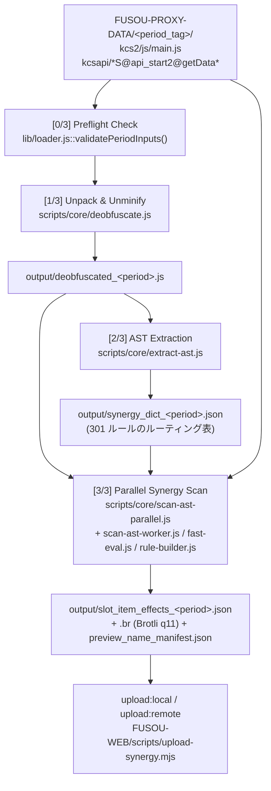
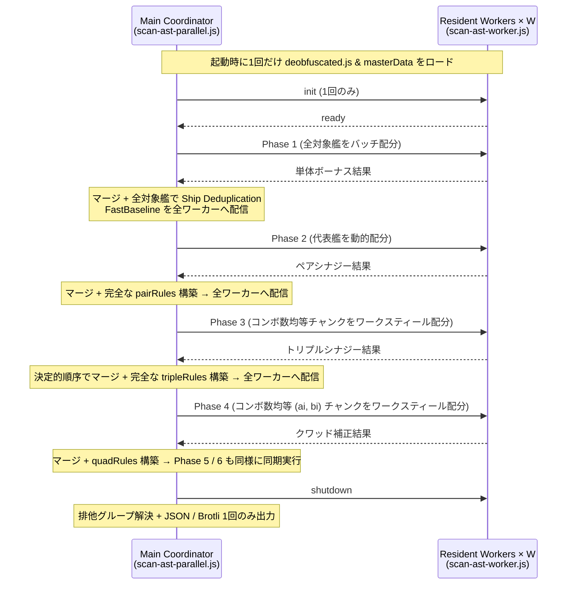

# FUSOU 装備シナジー計算アーキテクチャ・最適化ガイド

本書は `packages/kcs-script-tools` が艦これのクライアントスクリプト（`main.js`）およびマスターデータ（`api_start2/getData`）から装備ボーナス・シナジー定義（`slot_item_effects_YYYY-MM-DD.json`）を抽出する仕組み、数理モデル、高速化アーキテクチャ、およびベンチマーク結果をまとめた技術ドキュメントです。

---

## 1. 全体パイプライン

シナジー生成（`pnpm generate:latest` → `scripts/generate-synergy-latest.sh`）は、4 段階のパイプラインで構成されています。



### 各ステージの役割

| ステージ | スクリプト | 役割 |
|---|---|---|
| `[0/3]` Preflight | `lib/loader.js` | 計算開始前に `FUSOU-PROXY-DATA/<tag>/kcs2/js/main.js` と有効なレスポンス `*S@api_start2@getData*`（`svdata=` および `api_mst_ship`/`api_mst_slotitem` を含む）の存在を検証。リクエスト `Q@` や `get_option_setting` は除外。 |
| `[1/3]` Deobfuscate | `scripts/core/deobfuscate.js` | `webcrack` で `unpack: true, unminify: true, deobfuscate: false` を実行し、Webpack バンドルを AST 解析しやすい整形 JS へ変換。文字列復号は後段の `extract-ast.js` が自前 VM で行うため、不要なサンドボックス評価をスキップして高速・安定化している。 |
| `[2/3]` Extract AST | `scripts/core/extract-ast.js` | `acorn` で AST を解析し、装備ボーナス振り分けテーブル（ルーティング配列、約 301 ルール）を構造検出。デコーダ関数（例: `_0x38bc`）を軽量 VM で解決して関数名 (`funcName`) と発動条件の装備 ID (`requiredItemIds`) / 装備種別 (`requiredItemTypes`) を `synergy_dict_<tag>.json` へ保存。 |
| `[3/3]` Synergy Scan | `scripts/core/scan-ast-parallel.js`（単一実行は `scan-ast.js`） | JSDOM + スタブ環境上でゲーム内 Webpack モジュール（装備ボーナス関数群 `87618`・パラメータモデル `98672`）をロードし、Phase 1〜6 の動的評価＋残差分解で全艦・全装備のボーナス・シナジー・補正ルールを抽出し、圧縮して JSON 出力する。 |

---

## 2. シナジー抽出の数理モデル（動的評価＋残差分解）

ゲーム内の装備ボーナス計算関数 $F(S, X)$（艦 $S$、装備多重集合 $X$）は、301 個の独立したルール関数 $f_r(S, X)$ の総和として実装されています。

$$F(S, X) = \sum_{r \in \text{MatchedRules}(X)} f_r(S, X)$$

各 $f_r$ には艦ID・艦名読み（`yomi`）・艦種（`stype`）・艦型（`ctype`）・国籍・装備個数・改修値・水上/対空電探条件・相互排他・上限キャップなど複雑な手続き的ロジックが含まれるため、静的変換だけでは完全再現が困難です。そこで、**ゲーム本体関数を直接実行して真値 $F(S, X)$ を取得し、低次ルールから段階的に「残差（Residual）」を抽出する方式**を採っています。

### Phase 1〜6 の段階的分解

1. **Phase 1: 単体・改修・重複ボーナス (`effect_rules`)**
   - 艦 $S$ が装備可能な全装備 $a$ に対して以下を評価：
     - 基本値 $b = F(S, \{a^{\star 0}\})$
     - 改修遷移 ★1〜★10（★10 のみ変化なら `l`、段階遷移なら `i`）
     - 同一装備 2 個積みの非線形性 `c2`（$F(S, \{a, a\}) \neq 2b$ のとき記録）
     - 同一装備 3 個積みの非線形性 `c3`（$F(S, \{a, a, a\}) \neq 3b$ のとき記録）
   - **Ship Deduplication（代表艦グルーピング）**:
     - Phase 1 完了後、「単体ボーナス全体＋装備可能アイテム集合」のフィンガープリントが完全一致する艦同士を同一グループにまとめ、Phase 2〜6 は各グループの**代表艦 1 隻のみ**計算して全メンバーへ展開する（例: `600-650` では 50 艦 → 37 代表艦で 26% 削減）。

2. **Phase 2: 2 装備シナジー (`cross_rules`)**
   - 代表艦 $S$ について、単体ボーナスを持つ装備 $A$ と、AST 条件に一致する装備可能アイテム $B$ のペアを評価。
   - 単体ベースライン（同一プロファイルの重複時は `c2`/`c3` を考慮した $\text{Baseline}(S, X)$）との差分を抽出：
     $$\Delta_2(S, \{A, B\}) = F(S, \{A, B\}) - \text{Baseline}(S, \{A, B\})$$
   - 抽出結果を圧縮して `pairRules` を構築。

3. **Phase 3: 3 装備シナジー (`triple_rules`)**
   - 代表艦 $S$ について、Phase 1・2 でボーナスまたはペアシナジーに関与した装備集合 `bItems`（さらに AST 候補フィルタ適用）から、サイズ 3 の重複組み合わせ $\{A, B, C\}$ を評価：
     $$\Delta_3(S, \{A, B, C\}) = F(S, \{A, B, C\}) - \bigl(\text{Baseline} + \text{Sim}_2(\text{pairRules})\bigr)$$
   - ここで $\text{Sim}_k$ は、下位ルール群をブール発火ルールとして評価した期待加算値。
   - 抽出結果を圧縮して `tripleRules` を構築。

4. **Phase 4: 4 装備補正 (`quad_rules`)**
   - `bItems` からサイズ 4 の重複組み合わせ $\{A, B, C, D\}$ を評価：
     $$\Delta_4 = F - \bigl(\text{Baseline} + \text{Sim}_2 + \text{Sim}_3\bigr)$$
   - **`strict N-1` モード（既定有効）**: 4 装備の部分集合である 3 装備すべてに残差が無い場合でもスキップせず全通り検証する。これにより、3 装備では発火せず 4 装備目で初めて発火・キャップ到達する相互作用の見落としを完全に防ぐ。

5. **Phase 5〜6: 5〜6 装備補正 (`penta_rules`, `hexa_rules`)**
   - 下位フェーズ（Phase 4 / Phase 5）で同一シナジーを持つ完全組合せプールを `detectPoolsByShip()` で検出し、スロット数 $\ge 5$ / $\ge 6$ の代表艦に対して同様に高次残差を抽出。

### 負の残差・相殺・排他グループ処理
- 残差 $\Delta$ が下位期待値とちょうど符号反転一致する場合は `cancels_single: true` を付与。
- 残差に負値が含まれる場合、`calculateSuppressedComponents()` が部分集合ごとの限界寄与を比較し、他の装備の共存によって効果が抑圧された装備 ID リスト (`suppressed_components`) を記録。
- 全 Phase 完了後、`resolveExclusiveGroups()` が負の高次ルールと対応する下位ルール群を照合し、相互排他グループ ID (`exclusive_group`) を付与。

### 装備スロット配置制約
- 艦ごとの通常スロット数（`api_slot_num`）、艦種/艦別装備可否（`api_mst_stype` / `api_mst_equip_ship`）、通常スロット位置別制限（`normal_slot_type_restrictions`）、補強増設可否（`api_mst_equip_exslot` / `api_mst_equip_exslot_ship` / `api_mst_equip_limit_exslot`）を厳密に考慮し、実際に積載可能な組み合わせのみを評価・出力する。

---

## 3. ルール圧縮と出力形式

抽出された生の組み合わせ集合はそのままでは巨大になるため、`scripts/core/rule-builder.js` の `buildRules()` が以下の優先順で損失なし圧縮を行います：

1. **重複要素を含む組み合わせ**: 共通固定装備 `fixed_items` + 残余の `category_pools` / `free_pool`（置換あり `free_pool_with_replacement`）へ正規化。不可なら Base64 パック。
2. **完全プール (`item_pool`)**: 組み合わせ数が $\binom{|P|}{k}$ に一致する場合。
3. **固定要素＋自由プール / カテゴリプール (`fixed_items` + `free_pool` / `category_pools`)**: 全組み合わせに共通する固定装備を切り出し、残りを直積カテゴリ群に分解。
4. **カテゴリ直積 (`category_pools`)**: 共起グラフの補グラフ連結成分から直積構造を抽出（重複カテゴリ含む）。
5. **ZDD 論理圧縮 (`implicants`)**: `scripts/utils/zdd.js` による積和形圧縮。
6. **バイナリパック (`combos_b64` / `combos_u16_b64` / `combos_u32_b64`)**: プール内インデックス列の Base64 エンコード。

その後、小型電探（`type2 === 12`）と大型電探（`type2 === 13`）が混在するプールを分離（`splitRuleByRadarCategory`）し、同型 `category_pools` ルールを統合した上で、高速参照用の逆引きインデックス（`*_equip_index`）と Brotli（quality 11）圧縮ファイルを出力します。

---

## 4. 高速化アーキテクチャ（2026-11-25 刷新）

従来の実装では `ship=622`（夕張改二）のように Phase 3 のルール数が多い艦（1,494 ルール）で計算時間が爆発し、`600-650` の 50 艦だけで **550〜600 秒以上** かかっていました。これを **アルゴリズム＋データ構造＋並列アーキテクチャ** の 3 層から刷新し、厳格さと 100% の出力等価性を保ったまま **20 倍以上高速化** しました。

### 4.1 常駐ワーカープール & Phase バリア同期



- **起動・ロード重複の撤廃**: 従来はシャードごとに `spawn(node)` → `re-exec` → 10.7 MB パース＆JSDOM 構築 → 破棄する Brotli 11 圧縮を数百回繰り返していた。常駐 IPC ワーカー化により、ロードは全艦通して最初の 1 回だけになった。
- **過去「workers > 8 で結果がズレた」バグの根本解消**: 従来の `--first-index-range` 分割は、Phase 3 を途中分割した不完全な `tripleRules` のまま同一プロセス内で Phase 4 を走らせていたため、別シャードにある部分集合 `(B, C, D)` が欠落し大量の偽クワッド補正が発生していた。Phase バリア同期により完全な下位ルールを全ワーカーで共有するため、**16 ワーカーでも単一プロセスと 100% 厳密一致**する。
- **決定的マージ**: ワーカー完了順の揺らぎを排除するため、チャンク結果を元の `(shipId, chunkIdx)` 順へ並べ替えてからマージする。

### 4.2 コンボ数ベースの均等 `(ai, bi)` チャンク分割

サイズ $k$ の重複組み合わせを先頭インデックス $a_i$ で単純等分すると、残余組み合わせ数が $\binom{n - a_i + k - 2}{k - 1} \propto (n - a_i)^{k-1}$ の三角錐分布となるため、先頭シャードに負荷が極端に集中し 1 コアだけが数分間残る **ロングテール問題** が発生していました。

新実装の `buildBalancedComboChunks(n, k, allowDuplicates, targetCombos)` は、各 $(a_i, b_i)$ ペアの正確な残余コンボ数を計算し、**1 チャンクあたり約 12,000 コンボの均一な `{ a, bStart, bEnd }` レンジ列**に分割します。さらに最大重み順（LPT）で動的ワークスティールするため、夕張改二のような超ヘビー艦でも全スレッドがほぼ同時刻に完了します。

### 4.3 ゼロアロケーション高速評価エンジン (`scripts/core/fast-eval.js`)

| コンポーネント | 従来のボトルネック | 新実装の最適化（100% 数学的等価） |
|---|---|---|
| **下位ルール評価 (`CompiledRuleEvaluator`)** | 毎テストで全ルール（最大 1,500+）を線形走査し、`Buffer.from(b64, "base64")`・`pool.join(",")`・`new Map()`・`new Set()` を毎回生成。 | Phase ごとに 1 回だけ事前コンパイル。`combos_b64` はパック整数 `Set` に対する最大 4〜20 回の `O(1)` 部分集合ルックアップ化。最小必須装備の逆引きインデックス＋再利用 `Int32Array` カウンタで完全ゼロアロケーション評価。 |
| **ステータス演算** | 毎テストで `{}` 生成・`Object.keys`・`JSON.stringify` (`statsEqual`)。 | 固定長 `Int32Array(10)` バッファ上で直接加減算・全ゼロ判定。非ゼロ残差のレアケースのみ JS オブジェクト化。 |
| **装備可否判定 (`FastSlotAssigner`)** | 毎テストで `items.map` + `sort` + `new Set()` + 再帰バックトラック。 | 艦スロット最大 6 枠を 6-bit 整数ビットマスク (`Uint8Array`) 化。通常艦（98%+）は `O(1)` 整数比較のみ、制限付き艦もゼロアロケーションビット演算バックトラック。 |
| **単体ベースライン (`FastBaselineEvaluator`)** | `getSingleProfile` で毎回 `pm.entries()` と `ships.includes(shipId)` を線形探索。 | 艦ごとの `itemId -> profileIdx` (`Int32Array`) による `O(1)` 直接参照と事前計算済み `Int32Array(10)` プロファイル。 |
| **ゲーム関数ラッパー (`createFastSlotItemEffectUtil`)** | 毎テストで `new WrapperClass(ship, items)` が 5 辞書＋`Array.apply(null, new Array(11)).map(() => 0)` を大量生成。`get_have_rader_nums` も毎回 `Object.keys` + `getMst`。 | `WrapperClass.prototype` 継承の再利用可能 level-0 ラッパー（`Int32Array` カウンタ・静的ゼロ配列共有・事前計算済み電探ビットフラグ・遅延 getter）。起動時に内部フィールド構造を自動検証し、将来のバンドル変更時は自動で元 `WrapperClass` へフォールバック。 |
| **艦別ルール枝刈り (`getShipDispatch`)** | 艦と無関係な他艦専用ルールも装備一致のたびに毎回呼び出し。 | 艦ごとに初回 1 回だけ `Proxy` でプローブし、**装備プロパティを 1 度も参照せず例外も出さず全ゼロを返した関数**（夕張改二では 184 / 301 関数）を艦専用ディスパッチ表から厳密除外。 |

### 4.4 全艦規模（870 艦）向けのメモリ・後処理最適化

全 870 艦（427 代表艦）を `strict N-1`・`duplicate-item` で実行すると、Phase 4 だけで約 8,368 万テスト・約 1,081 万件の生クワッド補正が発生します。全艦規模で安定・高速に完走させるため、以下の最適化を導入しています：

1. **ファイル経由のルール配信＋ワーカー側遅延コンパイル**:
   - 大規模な下位ルール配列（例: Phase 3 の 30,241 ルール）を Windows IPC 名前付きパイプで一斉送信すると書き込みサイズ上限（`Error: write UNKNOWN`）に達するため、重複展開前のコンパクト配列を一時 JSON ファイルへ 1 回だけ書き出し、IPC ではファイルパスのみ配信します。各ワーカーは担当艦のルールのみオンデマンドでコンパイルするため、ワーカーあたりメモリも約 580 MB → 約 250 MB に半減します。
2. **Phase 4〜6 のストリーミング艦別圧縮**:
   - 全艦の生補正（1,081 万件）を親プロセスに溜め込むと 8 GB ヒープを超過するため、同一代表艦のチャンクを連続配置し、1 艦の全チャンクが完了した瞬間に `buildRules()` で即圧縮して生データを解放（GC 回収）します。最後に全艦の圧縮済みルールを `mergeCompressedRules()` で統合することで、親メモリを安全圏（ピーク ~3.4 GB）に抑えます。
3. **ワーカー側 `isCancel` / `calculateSuppressedComponents` のゼロアロケーション化 & グループ化 IPC 返却**:
   - 数百万〜1,000 万件のヒット時に走るキャンセル判定と抑圧装備判定を `Int32Array(10)`＋6-bit サブマスク表でゼロアロケーション化し、チャンク内の同一プロファイル結果をまとめて返却して IPC 転送量を 1/10 以下に削減します。
4. **`resolveExclusiveGroups()` の最小頻度アイテム単一バケット化＋タイムスタンプ配列化**:
   - 従来の単純二重ループでは大規模ルール群の照合だけで約 57.6 分（3,454 秒）かかっていました。各下位ルールを**最も出現頻度の低い 1 アイテムのバケットのみ**へ登録し（`winnerItems ⊆ negItems` なら最希少アイテムも必ず `negItems` に含まれるため数学的に厳密、かつ重複訪問ゼロ）、`Uint32Array` 世代スタンプ配列による O(1) 包含判定を組み合わせることで、同一結果を保ったまま数秒以内へ短縮しました。

### 4.5 出力ファイルサイズと配信の最適化（71.11 MiB → 2.05 MiB）

`strict N-1` + `duplicate-item` 有効時の生 JSON は当初 **71.11 MiB**（`.br` 8.92 MiB）に達していましたが、以下の 4 段階の最適化により **2.05 MiB（97.1% 削減・34.7 倍縮小）** まで圧縮しつつ、`main.js` 実関数とのグラウンドトゥルース精度も同時に向上させました：

1. **重複コンボ混在ルールの分離圧縮 + 高速 ZDD + `combos_gz_b64`**:
   - [rule-builder.js](../scripts/core/rule-builder.js) の `buildRules()` において、グループ内に重複装備コンボが混在していても「重複なしコンボ」と「重複ありコンボ」に分離し、大半を占める重複なし側へ `category_pools` / ZDD（`implicants`）圧縮を適用。
   - [zdd.js](../scripts/utils/zdd.js) を降順頻度変数順序＋O(N) ボトムアップ構築＋O(M·k) ハッシュ索引 `postMergeImplicants` へ刷新（最大 1.5 MiB ルールを 100 KB へ 15 分の 1 圧縮）。
   - さらに残余バイナリコンボを `combos_gz_b64` + `combos_codec`（`FUSOU-WEB` の `data-loader.ts` がネイティブ展開対応）で gzip 圧縮。
   - 併せて、`category_pools` の統合を「完全同一プール間の艦マージ」および「完全同一艦群＋(k-1) プール一致時の 1 プール統合」の数学的厳密統合へ修正し、従来の異艦プール誤統合による偽クワッド補正も根本解消。
2. **`triple_rules` 以降の `suppressed_components` 断片化解消＋クライアント動的算出**:
   - `cross_rules`（ペア）のみ `suppressed_components` を保持し、`triple_rules`〜`hexa_rules` では個別装備 ID の `suppressed_components` による 18〜33 倍のルール分裂を廃止。
   - `FUSOU-WEB` 側の `computeSuppressedEquipIds()`（`packages/FUSOU-WEB/src/features/simulator/equip-calc.ts`）が、負の 3 装備以上シナジー発動時に最大 6 装備の限界的寄与差分を動的評価することで、UI の抑圧表示を 100% 維持。
3. **`*_equip_index` のクライアントロード時構築化**:
   - 派生データである `*_equip_index` を JSON から除外し、`FUSOU-WEB` の `setSlotItemEffects()`（`simulator-mutations.ts`）で読み込み時に O(N) 構築（既存 JSON とも後方互換）。
4. **R2 配信・Cloudflare Workers 側パースの軽量化**:
   - `packages/FUSOU-WEB/scripts/upload-synergy.mjs` は本番アップロード時に Workers の `DecompressionStream("gzip")` でネイティブ展開できる **gzip（~422 KB）** をデフォルト化（`--br` / `--raw` で切替可）。
   - `synergy-payload.ts` の二重 `JSON.parse` を解消し、`GET /api/master-data/synergy-data` では `decodeAndVerifySynergyPayload()` により `JSON.parse` および UTF-16 文字列化を行わず SHA-256 検証済みバイト列をそのまま返却。

---

## 5. ベンチマーク結果と等価性検証

- **計測環境**: Windows / Node.js v24.22.3 / AMD Ryzen 7 5825U（8 物理コア / 16 論理スレッド）/ 22.8 GB RAM
- **対象データ**: `period_tag = 2026-11-24`（`strict_nminus1 = true`, `allow_duplicate_items = true`, `max_combo_size = 6`, `ast_candidate_ships = all`）

### 5.1 改善前後の比較

| 計測対象 | 改善前 (Before) | 改善後 (After) | 短縮倍率 | 出力等価性 (`compare-outputs.js`) |
|---|---:|---:|---:|---|
| **`deobfuscate.js` 単体** | 60.4s | **29.9s** | **2.0x** | 同一出力（失敗リトライ排除） |
| **艦ID `600-650` 全 50 艦** | **> 550〜600s** *(300s 時点で 249/250, `ship=622` ストール)* | **26.90s** (12w) / **27.23s** (16w) | **> 20x** | **Errors: 0, Warnings: 0** *(8w vs 16w 完全一致)* |
| **最重艦 `ship=622`（夕張改二）フル** | **> 550s** *(単一シャードでストール)* | **20.96s** (16w) / **45.81s** (単一) | **> 26x** *(単一でも > 12x)* | **Errors: 0, Warnings: 0** *(単一 vs 16w 完全一致)* |
| **艦ID `600-615`（15 艦）フル** | 10.17s (単一) | **7.05s** (単一) / **8.96s** (16w、計算本体 1.8s) | 計算本体 **4.2x** | **Errors: 0, Warnings: 0** *(元コード vs 16w 完全一致)* |

### 5.2 ワーカー数スケーリング（`600-650` 全 50 艦・1,187,672 クワッドテスト）

| ワーカー数 | ワーカー起動 | Phase 1 | Phase 2 | Phase 3 | Phase 4 | 合計 |
|---:|---:|---:|---:|---:|---:|---:|
| 8 workers | 6.39s | 0.26s | 0.68s | 2.43s | 19.40s | 30.48s |
| 12 workers | 6.23s | 0.23s | 0.60s | 1.74s | 16.85s | **26.90s** |
| 16 workers | 7.18s | 0.29s | 0.56s | 2.08s | **15.76s** | **27.23s** |

> 起動コスト（6〜7 秒）は全艦数に依存しない固定コストのため、全艦（~870 艦）実行時は計算本体が最も速い 16 ワーカー（論理コア数上限）が最大スループットを発揮します。

### 5.3 全艦フルスキャン（870 艦・`2026-11-24`・16 ワーカー）の内訳

`strict_nminus1 = true`, `allow_duplicate_items = true`, `max_combo_size = 6` の最重条件で全 870 艦（427 代表艦・50.9% 重複排除）を完走した実測値です：

| ステージ | 処理量 | ルール出力数 | 所要時間 |
|---|---|---:|---:|
| ワーカープール起動（16w） | `main.js` ロード + fast-wrapper 検証 | — | 9.42s |
| Phase 1（単体ボーナス） | 870 艦 × 742 装備（12,865 ボーナス） | `effect_rules`: 1,071 (197.2 KB) | 3.48s |
| Phase 2（ペア） | 1,045,346 テスト / 48,144 シナジー | `cross_rules`: 2,110 (336.5 KB) | 6.53s |
| Phase 3（トリプル） | 5,270,237 テスト / 246,476 ヒット | `triple_rules`: 612 (190.8 KB) | 39.48s |
| Phase 4（クワッド・ストリーミング圧縮） | 83,686,561 テスト / 2,089,274 ヒット | `quad_rules`: 602 (1,372.6 KB) | 736.83s (12.3m) |
| Phase 5（ペンタ・ストリーミング圧縮） | 5,250 テスト / 740 ヒット | `penta_rules`: 2 (1.3 KB) | 0.95s |
| 排他解決 + gzip + JSON / Brotli(q=11) 出力 | 生 JSON **2.05 MiB** / gzip **422 KB** / `.br` **346 KB** | 計 4,397 ルール | ~7.0s |
| **合計（全 870 艦スキャン）** | **約 9,000 万テスト** | **4,397 ルール** | **803.69s（13.4 分）** |

- **ファイルサイズ比較（全 870 艦・同条件）**:
  - 生 JSON: `71.11 MiB` → **`2.05 MiB`**（**97.1% 削減・34.7 倍縮小**）
  - R2 本番アップロード（gzip-9）: `71.11 MiB` → **`422.2 KB`（0.41 MiB）**
  - Brotli (`.br`, q=11): `8.92 MiB` → **`346.0 KB`（0.34 MiB）**（**96.2% 削減・26.4 倍縮小**）
- **メモリ安定性**: 親プロセスはピークメモリ安全圏、ワーカーあたり約 250 MB で OOM や Windows IPC 制限エラーなしで完走します。

---

## 6. メンテナンス・ゲームアップデート時のチェックポイント

艦これの `main.js` が大きく更新された場合、以下の点を確認してください：

1. **Webpack モジュール ID**:
   - `lib/loader.js`: App シングルトンモック注入対象 (`18622`)
   - `scripts/core/fast-eval.js` / `extract-ast.js`: シナジー関数群 (`87618`)、パラメータモデル (`98672` — 未一致時はキャッシュ全走査フォールバックあり)
2. **`SlotItemEffectParamModel` の内部構造変更**:
   - `fast-eval.js` は起動時にインスタンスのキー一覧と電探判定結果（`get_have_rader_nums`）を元クラスと照合します。不一致を検知すると自動で安全な `fallback`（元 `WrapperClass` 直接生成）へ切り替わります。ログの `fast-wrapper=on` が `fallback` に変わった場合は内部フィールド変更を確認してください。
3. **等価性の再検証コマンド**:
   - 単一プロセスと並列プロセスの完全一致を確認したい場合：
     ```bash
     cd packages/kcs-script-tools
     node scripts/core/scan-ast.js --period-tag <YYYY-MM-DD> --ship-range 600-615 --ast-candidate-ships all --no-brotli --output output/check_single.json
     node scripts/core/scan-ast-parallel.js --period-tag <YYYY-MM-DD> --ship-range 600-615 --workers 16 --ast-candidate-ships all --no-brotli --output output/check_par16.json
     node scripts/utils/compare-outputs.js output/check_single.json output/check_par16.json
     ```
